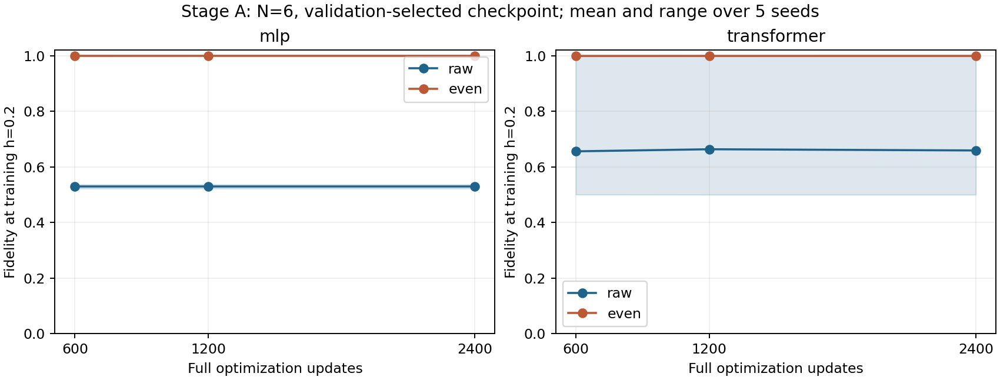
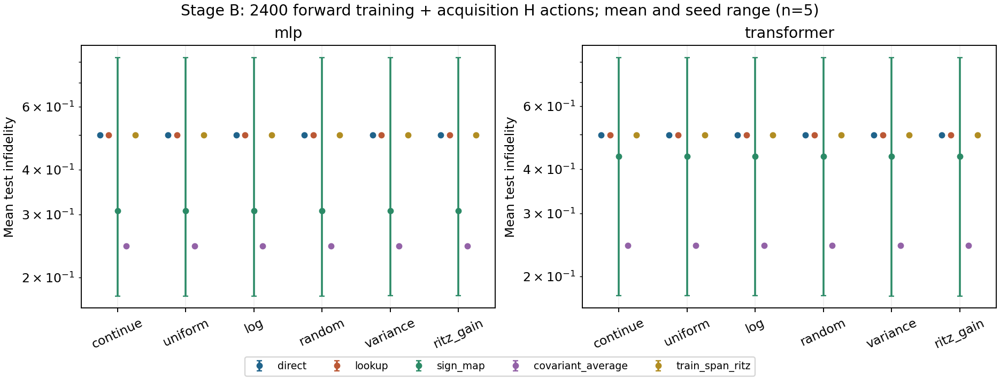
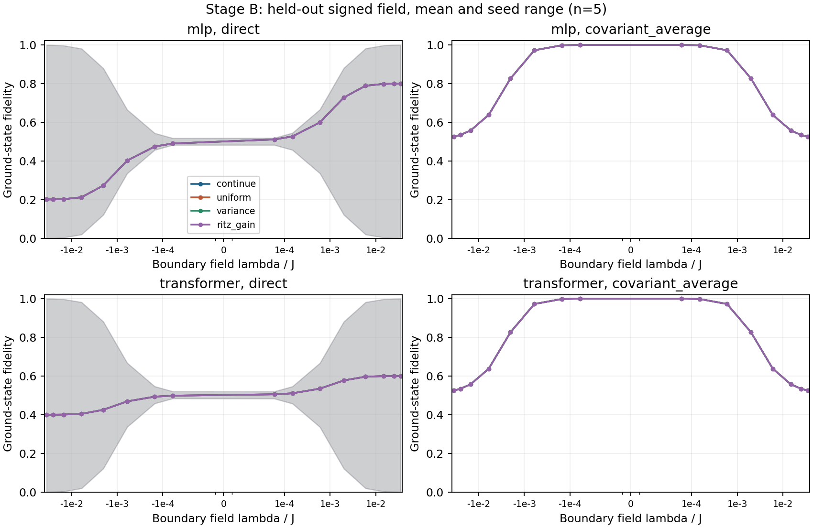

# 条件量子态研究：第二轮预算、选点与协变审查

2026-10-21 / Issue #3 / N=6 精确枚举初筛 / AI 辅助研究记录

## 本轮结论与证据范围

本轮没有获得主动选点优于简单基准的充分证据。更值得继续研究的是：在讨论参数泛化之前，必须分离训练点拟合、验证能量选模和参数协变三个因素。当前代码与数据支持这一问题分解，但还不支持 ICLR 级新算法主张。

共分析 120 个独立配置：阶段 A 为 60 组预算与宇称对照，其中复用首轮 12 组、新运行 48 组；阶段 B 新运行 60 组带符号纵场选点对照。每个比较包含相同的五个 seed：17、29、43、61、73。另保留一个超时失败记录和一次不计入统计的确定性重跑。完整统计来自 10650 行逐点指标。

以下数值结果标为 observed；两能级反例与敏感度界为 derived；优化条件数解释为 hypothesized；下一轮设计为 planned。尚未经过其他成员独立复现，项目正式共识文件 STATE.md 不作升级。

## 1. 研究问题与冻结协议

沿用第 12 题的开放 Ising 链、自回归条件网络和变分能量训练，使用 H(h,λ)=-ΣZiZi+1-hΣXi+λZ1。MLP 为 1569 参数，Transformer 为 2449 参数；二者规模不同，不能将性能差异全部归因于注意力结构。所有训练使用 CPU、float64、单个 PyTorch 线程、Adam 学习率 0.005。

阶段 A 固定 N=6、λ=0，比较 600、1200、2400 步与普通/正宇称训练。训练 h 为 0.2、0.8、1.4，验证 h 为 0.5、1.1。每 50 步按验证变分能量选 checkpoint。首轮已经观察过的插值/外推点在本轮明确降为开发诊断集，不再称为新的盲测证据。不同预算均从同一 seed 重新初始化。

阶段 B 固定 h=0.35，初始训练 λ={0,0.04}。在第 400、650、900 次更新后，比较继续训练、预定均匀新增点、预定对数新增点、随机新增点、最大能量方差选点、最大宇称子空间 Ritz 能量收益选点。候选 17 点与测试 16 点在执行前冻结且不相交；采集分数只使用 H 和预测态。训练与选点完成后才构造测试精确对角化结果。

阶段 B 评估五种预测：原始网络、同训练态查表、正场预测的符号映射、协变振幅平均、训练态张成空间的 Ritz 解。除继续训练外，各策略最终有五个训练点；继续训练始终只有两个。这一差别是要比较的资源分配选择。

原始协议见 [round2_preregistration.md](round2_preregistration.md)，配置与完整运行索引见 experiments/round2_index.json。执行代码先提交为 60d18bb；成本解释与异常处理修正为 b98f23f。阶段 B 与重跑均使用后者，未根据本轮结果修改种子、参数点或超参数。

## 2. 成本核查：相等的是前向预算

初始协议把计数写成总 H-vector actions，措辞不准确。实现实际计数的是前向训练及选点 H 作用。对 psi@H@psi 反向传播时还会发生一次 H 矩阵乘法；独立小型 profiler 记录确认了两次对应形状的矩阵乘法。

在阶段 B 尚未开始时，我们补充 ADR 0003 并保留冻结数值方案，不通过修改预算掩盖这一问题。所有策略前向训练加选点计数均为 2400，但包含反向传播后的工作量不同：

| 策略组 | 梯度更新 | 选点 H 作用 | 前向训练+选点 | 加反向后的 H 作用 |
|---|---:|---:|---:|---:|
| 继续/均匀/对数/随机 | 1200 | 0 | 2400 | 4800 |
| 方差选点 | 1175 | 51 | 2400 | 4749 |
| Ritz 收益选点 | 1124 | 153 | 2400 | 4647 |

自适应方法最后一个训练 batch 为单点，用完剩余奇数个前向预算。上述成本还不包含网络内部矩阵运算、SVD、小矩阵对角化、预测后处理和评估 ED。后处理与评估成本、模型调用次数、实际时间均单列于 manifest。因此本轮是前向资源轴匹配的初筛，不能宣称总算力完全相同或证明成本最优。

阶段 B 的平均每次运行墙钟时间：MLP 各策略约 1.26–1.37 秒，Transformer 约 3.73–4.17 秒；硬件执行环境下的这组时间不是可迁移性能保证。新成功运行的 48 组 A 合计 373.559 秒，60 组 B 合计 160.199 秒。另一次 A 运行经历长时间中断后触发超时，记录 38641.260 秒；中断原因未被日志确定，不能把这一数字解释为 CPU 计算时间。该失败目录保留，并在新目录重跑相同配置。成功用时合计不包含失败、安装、测试、制图与报告制作。

## 3. 增加训练预算后的结果

下表为训练点 h=0.2 的原始预测保真度 F，均值 ± 五种子样本标准差。它不是总体置信区间。

| 模型与训练约束 | 600 步 | 1200 步 | 2400 步 |
|---|---:|---:|---:|
| MLP 普通训练 | 0.528694 ± 0.00559 | 0.528694 ± 0.00559 | 0.528694 ± 0.00559 |
| MLP 正宇称训练 | 0.999793 ± 0.000108 | 0.999879 ± 0.0000527 | 0.999879 ± 0.0000527 |
| Transformer 普通训练 | 0.655996 ± 0.220 | 0.663477 ± 0.225 | 0.659149 ± 0.222 |
| Transformer 正宇称训练 | 0.999552 ± 0.000624 | 0.999640 ± 0.000659 | 0.999686 ± 0.000682 |

observed：普通 MLP 三个预算的结果完全相同，源于每个 seed 都选回第 550 或 600 步；并非证明后续模型参数完全不变。普通 Transformer 的种子差异很大，2400 步时 F 范围为 0.500102–0.999892。

推论边界：可说“增加最大训练步数没有让当前选模流程稳定解决低场错误”；不可说“更长优化无效”“模型容量不足已被证明”或“失败完全属于泛化”。本轮没有保存每个最终 checkpoint 的完整态，不能事后补报其保真度。下一轮需预先同时记录最终步与验证最优步，检查能量选模是否偏离关心的物理目标。

正宇称训练明显改善了这个已知对称任务，但这是 λ=0 的物理约束基准。不能把它直接用于 λ≠0 并声称仍预测正确的基态。

## 4. 有符号纵场：采样没有解决主要误差

下表报告固定测试网格上每种子的平均不保真度，再对五种子取均值；数值越低越好。完整样本标准差、最坏点误差、Z1 和关联误差、符号分层结果见 [完整统计表](results/round2/tables.md) 与同目录 CSV。

| 策略 | MLP 原始 | MLP 协变平均 | Transformer 原始 | Transformer 协变平均 |
|---|---:|---:|---:|---:|
| 继续训练 | 0.500262 | 0.244545 | 0.498972 | 0.243770 |
| 均匀新增 | 0.500260 | 0.244532 | 0.499007 | 0.243763 |
| 对数新增 | 0.500260 | 0.244532 | 0.499004 | 0.243764 |
| 随机新增 | 0.500261 | 0.244543 | 0.498980 | 0.243769 |
| 方差选点 | 0.500277 | 0.244552 | 0.498959 | 0.243765 |
| Ritz 收益选点 | 0.500306 | 0.244595 | 0.498965 | 0.243765 |

observed：Transformer 的方差选点在原始预测下比均匀新增平均降低不保真度 4.89×10^-5，五种子中赢四次；相对继续训练却只赢两次。采用协变平均后，相对均匀新增只赢两次，均值反而略差。MLP 的两个自适应方法在原始预测下均没有赢过均匀新增的任何一个 seed。

这些配对结果未通过预先设定的“稳定优于继续训练及两种固定网格，且排除简单协变控制”的晋级标准。这里没有进行显著性检验，也没有把 16 个相关参数点当作 16 次独立实验。微小差值不能用来掩盖约 0.5 的主要误差。

同训练态查表几乎重现了原始网络的误差，训练态张成空间的 Ritz 解也没有明显解决它。该结果只约束此处的已学训练态基，不否定 eigenvector continuation 本身；Ritz 保证的是所给子空间内能量最低，不保证子空间含有准确目标态。

训练点本身也存在严重失败。例如“继续训练”策略所有种子的已见训练点中，最小 F 为 MLP 的 0.000463、Transformer 的 0.000504；均匀新增也存在类似失败。因此不能把这些测试误差全部解释为训练点之间缺少采样。

## 5. 协变为何改善，却仍不构成可靠性保证

对归一化正实振幅 u(λ)，使用 v(λ) ∝ u(λ)+P u(-λ)。由 P 的幺正性可得 v(-λ)=P v(λ)；在 λ=0 它退化为偶宇称投影，但非零 λ 不强制固定场下的偶宇称。它需要两次网络预测及全态归一化；不是无代价的可扩展采样算法。

继续训练时，协变平均将 MLP 的平均不保真度从 0.500262 降至 0.244545，Transformer 从 0.498972 降至 0.243770。残余误差仍大：平均最坏点不保真度约为 0.476。仅把正场预测翻转到负场的符号映射也不稳健，其平均不保真度的种子标准差分别约为 0.288 和 0.353；选错正场分支会把错误复制到另一侧。

derived：考虑精确两能级 H(λ)=-(Δ/2)σx+λσz，恒定预测 |+x> 满足协变，但 F=[1+Δ/sqrt(Δ²+4λ²)]/2，Var(H)=λ²。令 Δ=t²、λ=t、t→0，方差及能量误差均趋近零，而 F→1/2。由此只能否定不依赖能隙的普适证书，不能推断固定正能隙下所有诊断都无效。

我们还由三角不等式推得：若两端 ±a 都要求高保真度，预测态在区间内必须具有足够大的参数导数。完整假设、证明与下一步可否定设计见 [理论记录](theory_round2.md)，两能级公式已与独立小矩阵本征求解核对。这不是新的定理优先权声明，也不是对六自旋模型作了有误差界的两能级约化。

hypothesized：原始 λ 输入很小、优化信号较弱或训练陷入分支可能限制参数敏感度。但本轮没有改变输入尺度、优化器或协变训练方式，不能把它们写成已证实原因。

## 6. 文献关系与论文判断

[Zhang 与 Di Ventra 的 TQS](https://arxiv.org/abs/2208.01758v4) 是本课题条件自回归表示的出发点；本项目固定 N、小网络、正实振幅与全枚举训练，是受限改编，不是完整复现其所有任务。

[Chen 与 Heyl 的优化研究](https://arxiv.org/abs/2302.01941v3) 提出 minimum-step stochastic reconfiguration。它提示优化不能被忽略，但我们未复现该算法，不能将当前 Adam 结果用于评价它。[Sarkar 与 Lee](https://arxiv.org/abs/2107.13449v2) 已研究主动自学习与 eigenvector continuation；主动选点及子空间修正不构成本项目的新颖性。

面向 ICLR 的本轮自评：可复现性、失败公开、信息隔离与强控制有所完善；实质性方法贡献、跨规模外部验证和公平总成本比较仍未完成。当前应写成研究报告和可审核的负面证据，而不是包装为投稿终稿。

下一轮 planned：先冻结新的 N/h 与参数网格，分离物理输入/域尺度归一化、普通/协变训练、最终步/验证最优步三个因素；明确计入反向成本，并保留按实际时间比较。只有训练点准确且这些控制仍不能解释收益，才继续投入更复杂的主动采样。优化器基准需单独核对计算成本。当前测试集不再承担确认性评价。

## 7. 复现、课程对照与协作交接

全部 16 项单元检查通过；独立证据核验脚本检查了 60+60 配置、10650 行指标、候选与测试隔离、前向预算、反向补计数、六策略共享的第 400 步参数哈希，以及变分能量界和协变关系。

确定性重跑选用 Transformer、方差选点、seed=17。其训练历史、逐点指标、选点分数与选择结果、最终权重哈希与原运行完全一致；仅忽略计时差异。这是同机复跑，不能代替独立成员复现。

最短复核命令：`.venv\Scripts\python.exe scripts/verify_round2.py`。重建表图：`.venv\Scripts\python.exe scripts/summarize_round2.py`。指定新标签进行单配置复跑：`.venv\Scripts\python.exe scripts/run_round2.py --stage b --arch transformer --policy variance --seed 17 --tag independent-round2`。运行前需提交 tracked 修改；新标签的复跑不加入既有统计索引。

第一轮报告和 course_requirements.md 保留第 12 题的模型推导、原文改编、训练/验证/测试划分及答辩问题。本轮补充多种子预算、破缺场控制与失败分析，不能替代三位成员实际学习、贡献记录及答辩。本文由 Codex 辅助编写、实现和执行；没有冒充人类成员的独立审核。

持久交接见 [Issue #3 handoff](handoffs/issue-3.md)。本分支依赖未合并 PR #2，以独立 PR 提交增量；不直接改动 main，不自动合并。
