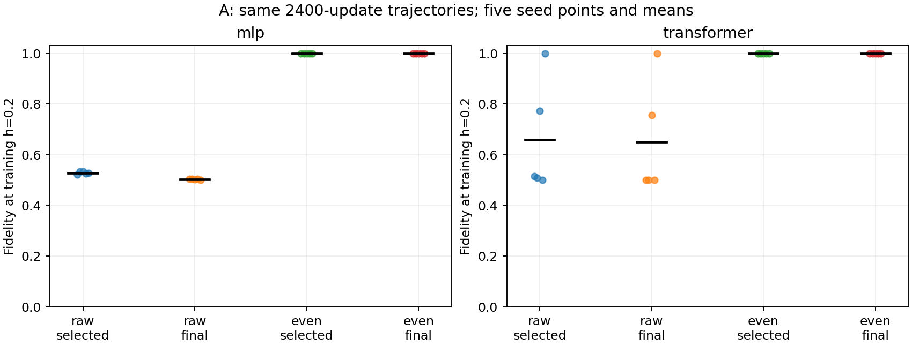
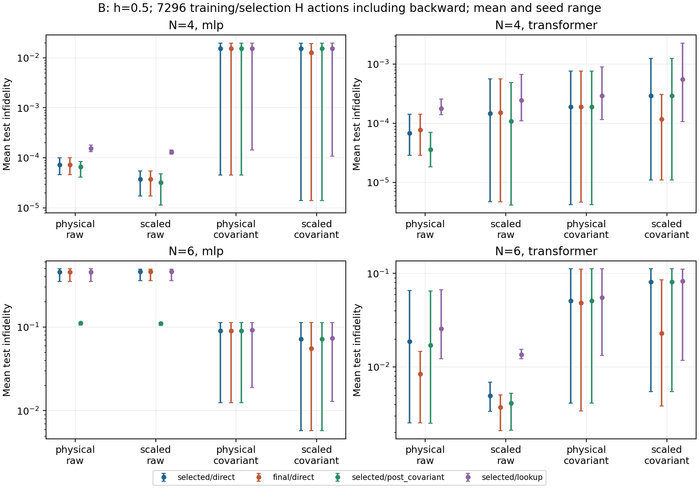
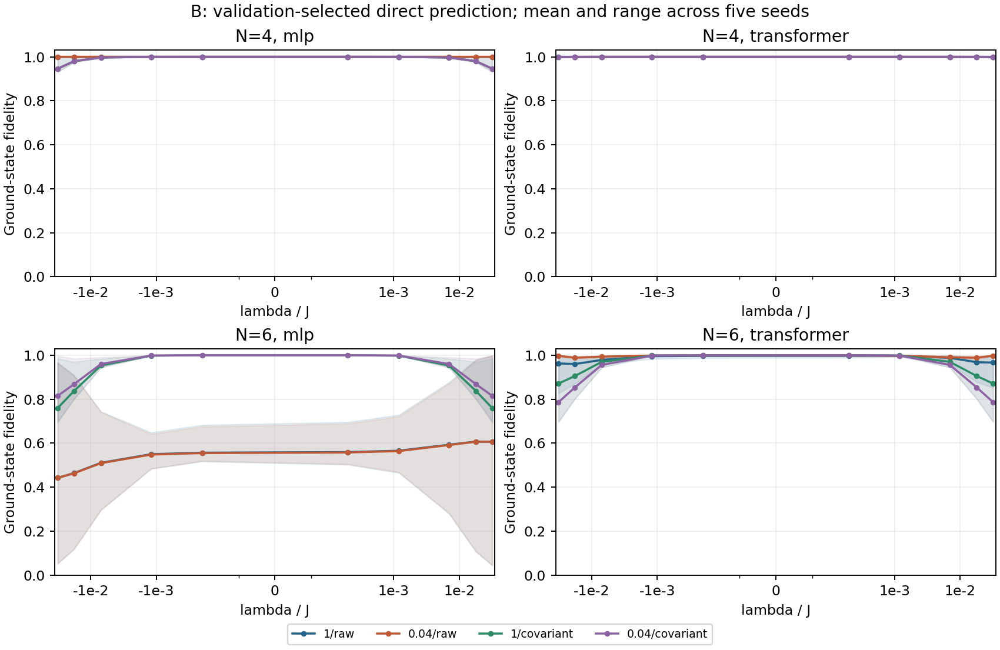

# 条件量子态研究：第三轮训练与参数化审查

2026-10-21 / Issue #5 / 冻结对照实验 / AI 辅助研究记录

## 本轮回答了什么

第三轮补齐了上一轮缺失的最终模型评估，并分离输入缩放、训练时协变和训练后协变三个因素。结果没有给出通用改进规则：普通 MLP 的原任务低场错误在最终步仍然存在；输入缩放改善了 N=6 普通 Transformer 的平均表现，但并非所有模型和尺寸均受益；训练时施加协变约束在若干配置中反而明显变差。

这使后续研究问题更明确：应研究这些训练失效何时发生、能否用不依赖精确态的诊断识别，而不能把简单采样或物理约束直接包装成新方法。当前仍是初筛研究，不是 ICLR 投稿终稿。

本轮新运行 100 个配置，每项五个配对 seed，另完成一次不计入统计的同机确定性重跑。100 个主运行全部成功，共保存 13880 行逐点指标，运行时间记录合计 462.711 秒；该时间不含重跑、测试、制图、安装和报告制作。数值事实标为 observed；重参数化推导标为 derived；后续因果解释标为 hypothesized/planned。尚无跨成员独立复核。

## 1. 从上一轮问题到冻结实验

阶段 A 直接复跑原 N=6、λ=0 任务：训练 h={0.2,0.8,1.4}，验证 h={0.5,1.1}，MLP/Transformer、普通/正宇称训练、五个 seed，共 20 组，每组 2400 步。训练结束后同时评估最终步和验证能量最优步，不按精确保真度选模型。这些 h 网格已在前两轮使用，属于开发诊断数据。

阶段 B 使用 N={4,6}、h=0.5 的新冻结网格，训练 λ={-0.04,0,0.04}，验证 λ={±0.003,±0.012}，测试 λ={±0.0002,±0.0012,±0.007,±0.018,±0.032}。两个模型、两种输入尺度、两种训练约束、五个 seed 构成 80 组配置。全部使用 1200 次全批量 Adam 更新、学习率 0.005、每 50 步验证。

输入为物理 λ 或 λ/0.04；0.04 来自训练域边界，不来自精确能隙。协变训练使用归一化的 u(λ)+P u(-λ)，其中 P 为全局自旋翻转，梯度穿过两次预测及归一化。它在非零 λ 下不强制固定场偶宇称。所有模型仍采用原有因果自回归结构，关闭 dropout，以正实振幅和全枚举变分能量训练。

主指标在执行前规定为“验证选中模型的直接预测，在测试网格上的每种子平均不保真度”。最终步、最坏点、训练点、Z1、关联误差及后处理均为已声明的次指标。精确对角化只在训练与 checkpoint 冻结后用于评估。

完整配置及协议见 [冻结协议](round3_preregistration.md) 与 experiments/configs/round3.json。全部主运行和重跑的数值代码均来自提交 ae5236a。阶段 B 同时改变了 h 和训练点安排，不能把跨轮误差变化直接归因于输入尺度；可解释的对照是本轮相同任务内部的配对比较。

## 2. 最终模型是否只是被验证选模遗漏

20 组 A 的完整训练历史、验证选中模型逐点指标均与第二轮精确匹配，说明新评估程序保留了原训练轨迹，而非通过改动训练得到另一组结果。

下表为训练点 h=0.2 的保真度 F，均值 ± 五种子样本标准差；不是置信区间。

| 模型与训练方式 | 验证选中模型 | 第 2400 步模型 |
|---|---:|---:|
| MLP 普通 | 0.528694 ± 0.00559 | 0.503493 ± 0.00134 |
| MLP 正宇称 | 0.999879 ± 0.0000527 | 0.999986 ± 0.00000817 |
| Transformer 普通 | 0.659149 ± 0.222 | 0.651486 ± 0.224 |
| Transformer 正宇称 | 0.999686 ± 0.000682 | 0.999997 ± 0.00000281 |

observed：普通 MLP 五个 seed 的最终步都比验证选中模型更差。原任务的低场错误不能仅归咎于验证规则选择了早期 checkpoint；在当前 Adam 配置下，延长到 2400 步的最终模型也未解决问题。但这不排除其他学习率、优化器或更长训练的可能性。

正宇称训练的最终步在该点更准确。它只是训练点 h=0.2 的比较，不证明最终模型在全部验证、插值或外推参数上优于验证选中模型，也不构成废除验证选模的理由。全网格指标保存在逐点记录中。

## 3. 新网格的尺度与协变全因子结果

下表是阶段 B 主指标，即验证选中模型直接预测的平均测试不保真度，越低越好。每格均为五种子均值 ± 样本标准差，所有配置都报告，不按结果选出最有利模型。

| 尺寸与模型 | 物理输入/普通 | 缩放输入/普通 | 物理输入/协变 | 缩放输入/协变 |
|---|---:|---:|---:|---:|
| N=4 MLP | 7.21e-5 ± 2.12e-5 | 3.78e-5 ± 1.64e-5 | 0.01549 ± 0.00864 | 0.01538 ± 0.00859 |
| N=4 Transformer | 6.81e-5 ± 4.51e-5 | 1.47e-4 ± 2.35e-4 | 1.88e-4 ± 3.23e-4 | 2.90e-4 ± 5.41e-4 |
| N=6 MLP | 0.45439 ± 0.0592 | 0.45562 ± 0.0572 | 0.09030 ± 0.0436 | 0.07159 ± 0.0529 |
| N=6 Transformer | 0.01869 ± 0.0265 | 0.004909 ± 0.00145 | 0.05096 ± 0.0559 | 0.08111 ± 0.0465 |

observed：在普通训练下，缩放使 N=4 MLP 的五个 seed 全部改善；N=6 Transformer 平均不保真度从 0.01869 降到 0.004909，五个 seed 中改善四个。然而 N=4 Transformer 只有两个 seed 改善，N=6 MLP 只有一个改善。不能据此宣称缩放普遍解决条件网络失效。

训练协变的效果也不统一。N=6 MLP 在两个尺度下均比同尺度普通直接预测改善全部五个 seed，但仍有明显残余误差。N=4 MLP 在每个尺度下都只有一个 seed 从协变训练受益。N=6 Transformer 在缩放条件下，协变训练的五个 seed 全部比普通训练更差，均值从 0.004909 增至 0.08111。

这些是有限网格上的配对描述，不是显著性检验。不同 λ 的相关观测不作为独立样本，跨配置平均也不作为新的“重复实验”。完整每种子值、配对差分与最坏点指标见 [统计表](results/round3/tables.md) 及同目录 CSV/JSON。

## 4. 与训练后协变和子空间基准相比

只与普通直接预测比较会夸大训练约束的必要性。例如 N=6、缩放 MLP：普通直接预测平均不保真度 0.455618，训练后协变平均为 0.110584，协变训练为 0.071594。后者相对训练后协变只赢三个 seed，并非五个 seed 都需要训练时约束。

N=6、缩放 Transformer 的结果更明确：普通直接预测为 0.004909，训练后协变为 0.004121，而协变训练为 0.081112；协变训练比这两种普通训练结果都差，五个配对 seed 一致。这不否定所有协变网络，只否定当前幅度平均构造和优化配置下的通用收益主张。

同一 N=6、缩放普通 Transformer 的查表基准为 0.013566，直接网络优于该查表均值；训练态张成空间的 Ritz 结果为 0.0001392。后者使用额外的 H 运算和小矩阵求解，不能当成无代价的直接网络预测。它提示高精度优势仍须与已知子空间方法比较，不能只选较弱查表基准。

## 5. 缩放没有扩大模型的函数集合

derived：在当前 MLP 和 Transformer 中，λ 只通过一个仿射层进入网络。将 λ 改为 λ/s，同时将该输入对应权重列 w 改为 w'=s*w，仿射层输出保持不变，后续所有自回归振幅也保持不变。这个变换可逆，对协变平均后的状态同样成立。因此这两种输入尺度具有相同的可表示函数集合。

本轮使用相同的随机权重，但没有进行上述补偿，所以缩放同时改变初始预测函数和优化参数化。初始参数哈希相同不代表初始量子态相同。不能把观测收益全部称为条件数改善，更不能称为表达能力增强。

在函数匹配的初始化下，梯度变换为 g'=g/s。固定学习率的 Adam 首步换算回物理系数后，其更新为 -(η/s)g/(|g|+sε)；与原坐标的 -ηg/(|g|+ε) 不同。当梯度远大于 ε 时，单个相应权重的有效步幅约相差 1/s。本轮 s=0.04 对应因子 25，但这不是 25 倍训练加速的预测。

完整推导与限制见 [参数化理论记录](theory_round3.md)。补偿权重列后的两模型振幅等价性已用多个 h、正负 λ、普通及协变输出进行数值检查。下一轮若要作因果归因，需要预先加入函数保持初始化及相应优化器坐标控制；本轮没有运行这些训练实验。

## 6. 公平预算、复现与课程要求

本轮从设计时计入反向 H 运算。阶段 A 每组 7200 次训练前向、7200 次反向、96 次验证，共 14496 次训练与选模 H 作用；阶段 B 每组为 3600+3600+96=7296 次，且均为 1200 次梯度更新。评估 ED、后处理 H 作用、模型调用和时间另列。

阶段 B 普通训练每组 3600 次训练网络调用，协变训练每组 6000 次；验证调用分别为 96 和 192 次。因此 H 预算和更新次数相同不代表整个计算量相同。实际平均每次运行时间：N=4 MLP 普通/协变约 1.30/1.91 秒，Transformer 3.57/5.47 秒；N=6 MLP 1.75/2.71 秒，Transformer 5.66/9.05 秒。时间来自本机 CPU 单线程记录，不是跨设备性能保证。

全部 100 个主配置均有独立目录、种子、配置哈希、源提交、两种 checkpoint 的状态哈希、训练历史和逐点指标。证据核验覆盖完整全因子组合、初始权重配对、预算、数据隔离、归一化与变分界；20 组旧轨迹精确匹配。额外的 N=6 缩放协变 Transformer、seed=17 重跑，与原运行的训练历史、两种 checkpoint 全部指标及状态哈希完全一致。它仍是同机重跑，不冒充独立成员复现。

第 12 题的多 h 自回归 Transformer、验证选模、插值/外推及查表对照延续阶段 A 和首轮材料；阶段 B 增加 N=4/6 与物理约束对照。本轮报告不替代成员真实贡献记录、原文理解与答辩。18 项训练前检查通过；增加缩放等价性检查后，最终 19 项测试全部通过，三轮证据核验及全部 225 个运行记录的结构校验也通过。

复核命令：`.venv\Scripts\python.exe scripts/verify_round3.py`。重建图表：`.venv\Scripts\python.exe scripts/summarize_round3.py`。复跑命令与协作分支见 [Issue #5 交接记录](handoffs/issue-5.md)。正式 STATE.md 结论仍等待其他成员独立复核。

## 7. 论文定位与下一步

[Zhang 与 Di Ventra 的 TQS](https://arxiv.org/abs/2208.01758v4) 仍是条件自回归表示的原始参考；本轮是固定小尺寸、正振幅、全枚举的受限研究。[Chen 与 Heyl 的深层 NQS 优化研究](https://arxiv.org/abs/2302.01941v3) 提醒我们需要优化器对照，但本轮没有实现或评价其 minimum-step stochastic reconfiguration 方法。我们没有把常见输入缩放、协变平均或 Ritz 修正称为新算法。

目前有了可复现的条件差异与反例，尚缺少独立复核、可预测失效的机制、跨 h/尺寸验证及可扩展训练。面向 ICLR 的下一项可验收问题，应是：在保持初始函数一致并控制优化器坐标后，哪些无精确态诊断能预测分支学习失败？如果这些控制消除了现象，应收缩为优化参数化结论；若仍存在稳定失效，再考虑诊断与训练资源分配方法。

以上属于 planned，不是已经证明的新贡献。当前新网格在本轮后转为开发集，不继续据此调参并宣称确认性提升。本文与代码由 Codex 辅助整理和执行，尚未冒充人类同行评审。
