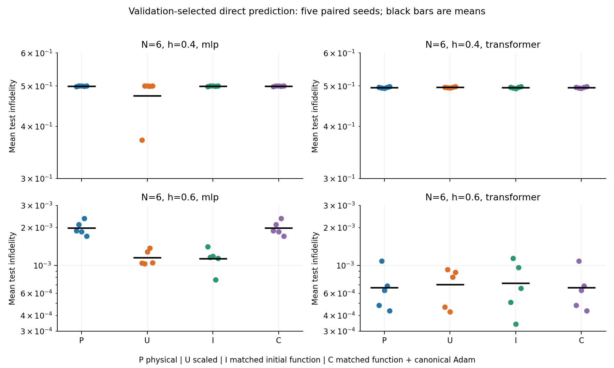
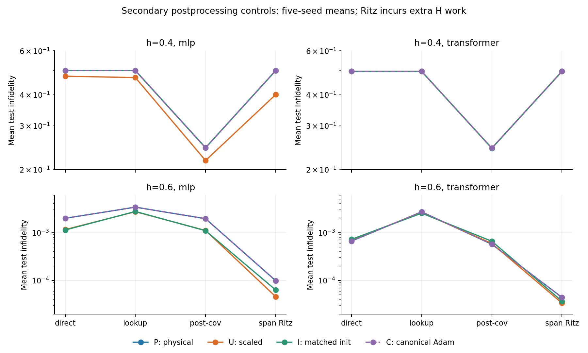

# 条件量子态研究：初始化与优化器坐标的分离

2026-10-22 / 第四轮 / Issue #7 / AI 辅助研究记录

## 本轮结论与证据范围

输入缩放并不扩大当前条件网络的函数集合；它可以同时改变初始预测函数和优化器更新。第四轮将两者拆开：保持初始函数并在物理坐标中执行 Adam 时，20 对实验的训练历史、输出振幅和全部评估指标均逐值一致；仅保持初始函数、仍使用缩放坐标下的普通 Adam，则可以改变精度，但收益依赖模型与任务。

具体而言，N=6、h=0.6 的 MLP 在匹配初始函数后，平均测试不保真度从 0.001984 降至 0.001131，五个种子全部改善；同一干预对 Transformer 只有一个种子改善、四个变差。h=0.4 的主要训练失败仍未解决。这些结果支持研究具体的优化失效机制，不支持把缩放包装成新量子态表示或通用算法。

Material Passport：code experiment / descriptive validation；输入为第三轮交接与重参数化推导；输出为冻结配置、80 组主运行、一次独立目录同机重跑及本报告。运行记录合计 335.170 秒，不含重跑、测试、绘图和报告制作。observed 表示实测，derived 表示在明确假设下推导，planned 表示尚未执行。所有结果仍待成员独立复核；当前不是 ICLR 投稿终稿。

## 1. 四个对照如何分离问题

| 组别 | 输入 | 初始权重列 | 优化器坐标 |
|---|---|---|---|
| P：物理输入 | λ | 原始 w | 物理坐标 Adam |
| U：直接缩放 | λ/s | 原始 w | 缩放坐标 Adam |
| I：匹配初始化 | λ/s | s·w | 缩放坐标 Adam |
| C：完整补偿 | λ/s | s·w | 物理坐标 Adam 后映回 |

s=1/16，既是训练纵场边界，也可精确表示为二进制指数移位。选择它是为了检查坐标等价性，不使用精确能隙。P 与 I 的初始预测完全相同，所以差异来自后续坐标更新；U 与 I 使用相同的缩放坐标优化器，差别是初始函数。C 是等价性对照，不能被当作新增的性能方法。两种干预可以交互，不能将 U-P 的变化拆成唯一的“初始化贡献百分比”和“条件数贡献百分比”。

实验在 N=6，h={0.4,0.6}，MLP/Transformer，seed={17,29,43,61,73} 上运行四组，共 80 组。每个 h 对应独立训练的模型，并非跨 h 泛化测试。训练 λ={-0.0625,0,0.0625}；验证 λ={±0.004,±0.02}；测试 λ={±0.0003,±0.0015,±0.008,±0.027,±0.052}。三个划分互不重叠。

所有模型保留因果自回归、正实振幅和关闭 dropout 的实现。每组 1200 次全批量 Adam 更新，学习率 0.005，ε=1e-8，float64、CPU 单 Torch 线程。每 50 步按验证变分能量选模，同时保留最终步；精确对角化只在二者冻结后用于评估。主指标预先固定为验证选中模型的逐种子平均测试不保真度。完整协议见[冻结记录](round4_preregistration.md)，数值源码提交为 414e785。

## 2. 精确坐标对照及其证明

derived：假设 λ 只通过仿射列 w 进入模型，令 w'=s·w，输入改为 λ/s，则第一层贡献不变，所有后续输出不变。若损失在两组物理参数相同时一致，链式法则给出该列的梯度 g'=g/s，其余参数梯度不变。

每次反向传播后，将 w' 除以 s、其梯度乘以 s，再用物理坐标中的 Adam 动量执行更新，最后将更新后的列乘回 s。由归纳法，每一步物理参数、动量、预测和损失都与 P 相同；验证选模采用同一确定性规则，因此选中步也相同。假设包括相同批次与超参数、零权重衰减、无梯度裁剪，以及从第一步起使用同一动量坐标约定。完整证明、等价的逐坐标学习率/ε变换与反例见[理论记录](theory_round4.md)。

这不是新的优化器。实现只是对已有 Adam 做坐标转换；[Adam 原始论文](https://arxiv.org/abs/1412.6980v9)与[PyTorch 2.14 文档](https://docs.pytorch.org/docs/2.14/generated/torch.optim.Adam.html)提供算法背景。梯度缩放的不变性质与参数坐标变换下的物理轨迹不变性是不同命题，不能混用。

observed：完整核验覆盖全部 20 对 P-C。两组的 24 个记录时刻、选中步、初始训练点振幅、选中和最终模型的 17 点振幅，以及全部后处理指标都逐值相同。检查并非复制对照结果，而是各自独立训练后比较保存的数组。预先容差为绝对 1e-10 加相对 1e-8，实际得到更强的逐值一致。额外的 C 组 Transformer、h=0.4、seed=17 同机重跑也完全一致。它不构成跨机器或跨成员复现。

## 3. 普通 Adam 下，哪些收益还存在

下表是不保真度，越低越好；均值 ± 五种子样本标准差，不是置信区间。主指标只使用 selected/direct/test，所有其它指标完整保留在[统计表](results/round4/tables.md)。

| h / 模型 | P 物理输入 | U 直接缩放 | I 匹配初始化 | C 完整补偿 |
|---|---|---|---|---|
| 0.4 / MLP | 0.49977 ± 0.00065 | 0.47427 ± 0.05769 | 0.49968 ± 0.00088 | 0.49977 ± 0.00065 |
| 0.4 / Transformer | 0.49602 ± 0.00196 | 0.49636 ± 0.00146 | 0.49582 ± 0.00221 | 0.49602 ± 0.00196 |
| 0.6 / MLP | 0.001984 ± 0.000258 | 0.001155 ± 0.000160 | 0.001131 ± 0.000230 | 0.001984 ± 0.000258 |
| 0.6 / Transformer | 0.000664 ± 0.000256 | 0.000702 ± 0.000238 | 0.000721 ± 0.000326 | 0.000664 ± 0.000256 |

observed：h=0.6 的 MLP 中，I-P 的逐种子差值全部为负，均值为 -0.00085298；U-P 也全部为负，均值为 -0.00082915。即使保持初始函数不变，坐标更新仍可影响该配置的有限预算精度。因此不能将本轮 MLP 的缩放收益完全归因于初始化变化。U 与 I 的差异则有正有负，未表现为统一方向。

h=0.6 的 Transformer 中，I-P 只有 1/5 改善，平均差为 +0.00005721；U-P 有 3/5 改善，但平均差为 +0.00003771。平均值方向与胜出次数回答不同问题，两者都报告。它们不支持普通缩放在两种网络间有通用收益。

h=0.4 的 MLP 中，U 的均值下降主要由 seed=17 驱动：该种子的平均不保真度由 0.498662 降为 0.371075，其余四个仍约为 0.5。I 的五种子均值仍为 0.499681。这个固定坐标下的初始化对照提示了路径依赖，但未证明“初始态决定全部失败”。Transformer 的四组也都约为 0.496。不能用一个有利种子掩盖低场整体失败。

次要的最终步结果没有改变上述主要模式：h=0.4 全部组以及 h=0.6 的 MLP 选中步均为最终步；h=0.6 Transformer 的最终均值 P/U/I 为 0.000622/0.000692/0.000683。我们不据此更换主指标或弃用验证选模。

## 4. 失败发生在哪一层

observed：h=0.4 的 P 组，MLP/Transformer 的平均训练点不保真度已经分别达到 0.499933/0.497098，测试点约为 0.499775/0.496016。因此主要问题在训练阶段已存在，不能仅解释为未见参数的插值失败。完整补偿不会改善这类失败，因为它按构造重现原轨迹。

训练态子空间 Ritz 也没有在这些 P 组中恢复精度，测试均值仍为 0.499718/0.496014；训练后协变平均降为 0.244747/0.243807，仍有明显残余。反之在 h=0.6 的 P 组，直接预测优于同训练态查表，但 Ritz 进一步将 MLP/Transformer 测试均值降至约 9.90e-5/4.44e-5。不能只挑查表作为唯一对照，也不能把额外 H 作用和小矩阵求解包装为无成本网络预测。

这些对照区分了训练失败、条件插值和后处理能力，但还没有解释低场训练为何陷入错误状态。全枚举 N=6、正实振幅、两个横场值和一个预算不足以建立普适失效理论。

## 5. 预算、复现与研究完整性

每组均为 3600 次训练前向 H 作用、3600 次反向 H 作用、96 次验证 H 作用，共 7296 次；训练/验证模型调用为 3600/96，另有六次初始化对照调用。两种 checkpoint 的评估共 34 次模型调用、272 次指标 H 作用、17 次精确对角化；Ritz H 工作按实际秩单列。C 组另有 1200 次坐标转换。没有声称壁钟成本严格相等。

按模型与组别、跨两个 h 的实测平均时间，MLP 的 P/U/I/C 分别为 2.09/1.90/1.90/1.93 秒，Transformer 为 6.48/6.27/6.43/6.52 秒。运行次序固定，首运行开销、系统负载均会影响时间，所以这些是本机记录，不是速度优越性的统计证据。

80 组主运行全部成功，逐点指标共 10880 行，逐种子端点 1920 个。22 项单元测试通过，包括两个网络、两种尺度、不同 ε 的多步参数/梯度/动量一致性；306 份全仓运行记录结构通过校验。完整控制核验和同机重跑均通过。分析导出曾因重复 h 字段报错，修复导出器后重新生成；没有修改或重跑主实验，也没有丢弃数据。

统计检查逐项覆盖 11 类解释风险，详见[统计边界](results/round4/statistical_scope.md)。不将 λ 网格点当成独立重复，不合并不同 h/架构宣称总体收益，不以五种子的描述统计声称显著性。全部配对差值、阴性结果、原始振幅与成本可追溯。正式 STATE 共识仍等待独立成员复核。

## 6. 课程要求与下一步

第 12 题的多 h 条件 Transformer、验证选模、内插/外推及查表对照由首轮材料覆盖；本轮是针对优化坐标的扩展研究，不能替代原题要求，也不把两个分别训练的 h 当作新的多 h 共享模型实验。成员的实际阅读、分工记录及答辩仍须本人完成。

planned：下一项可验收研究应比较低场任务的单哈密顿量独立拟合与共享条件拟合，并加入明确计算预算的优化器基线，判断失败来自通用优化、共享参数干扰，还是未学到两侧分支。先在训练点建立可信的拟合能力，再讨论主动选点；以后扩展尺寸与采样训练时，也必须保留这些对照。当前没有执行这些新实验。

本轮关闭了“缩放是否改变函数集合”和“能否通过坐标补偿重现原轨迹”两个具体问题，却没有产生投稿级新算法。下一阶段应追求可预测、可证伪的失效机制与干预，而不是继续堆叠未经归因的小幅改进。复核命令、独立重跑入口与风险见[交接记录](handoffs/issue-7.md)。
