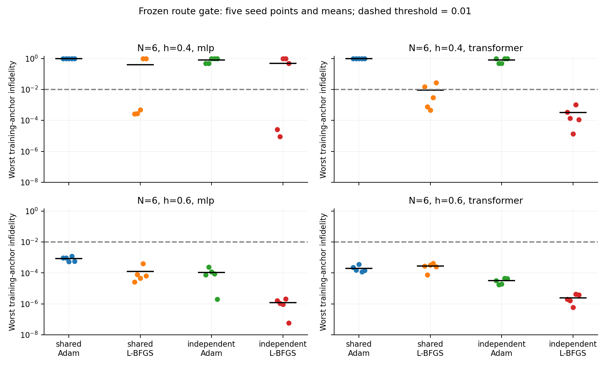

# 条件量子态研究：路线评估与训练失败归因

2026-10-22 / 第五轮 / Issue #9 / AI 辅助研究记录

## 1. 对最终目标的判断与决策

前四轮已经把项目从预实验推进到可追溯的研究基准：实现、物理检查、重复种子、同源基线、负面结果和复现记录基本齐备。它们主要排除了混杂，没有建立足够强的新方法贡献。课程第12题已有可用材料基础，仍需成员独立复核、真实分工记录和答辩；这些不能由增加实验组数替代。ICLR 级论文仍缺可成立的新问题、强基线下的稳定增益、规模扩展与完整成本证据。

因此，本轮先作路线决策，再冻结并执行判别实验：暂缓主动选点、输入缩放和协变组合的算法叙事，检查失败究竟是否依赖条件共享，及其是否主要来自普通 Adam。详细的事前评估见[路线评估](strategy_after_round4.md)，判别门槛见[冻结协议](round5_preregistration.md)。本报告保留事前决策与事后解释的区别。

完成实验后的决定是：保留“近简并条件量子态的可靠训练及其摊销价值”作为候选问题；不认定共享参数已被证明是失败原因，也不认定更换优化器已经构成论文方法。下一阶段首先检查更强优化与容量/更新匹配对照，再检查尺寸和查询总成本。继续密集扫描采样点或直接拼投稿稿件，当前信息收益较低。

Material Passport：code experiment / descriptive validation。输入为前四轮证据，输出为80组主实验、一次同机独立目录重跑、完整原始记录与路线判断。observed 是实测，derived 是条件推导，hypothesized 是待检验解释，planned 是尚未执行。所有科学结论仍待独立成员复核；本报告不是 ICLR 投稿终稿。

## 2. 冻结的实验与成本边界

数值源码和配置在提交 2acdc205d9fcb46335547216dc73d4d7c04abc0d 冻结。N=6，横场 h={0.4,0.6}，MLP/Transformer，五个配对种子17、29、43、61、73，交叉共享/独立与 Adam/L-BFGS，共80组。每个 h 独立训练，不能解释为跨 h 泛化。训练纵场为 {-0.0625,0,0.0625}，主动复用第四轮开发锚点；新测试网格为 ±{0.0005,0.0025,0.01,0.035,0.057}。

共享模型同时拟合三个锚点；独立组为每个锚点各建一个模型。二者从同一采样权重开始，独立组的三个副本也相同。共享模型执行1200次梯度 closure；独立组每个模型1200次，共3600次。每组均为3600次前向与3600次反向 H 作用、3600次训练网络调用。梯度是每自旋变分能量；不用精确谱、测试集或验证选择模型，报告固定预算最后接受的参数。

Adam 学习率0.005；L-BFGS 学习率1、历史长度20、每步 max_iter=1、strong-Wolfe 线搜索。所有 closure 均计费，包括拒绝的试探与当前点重复计算。若预算在某步中耗尽，恢复该步开始前的已接受参数，已消耗工作不退还。主实验合计52次 closure 属于这种最终回滚步骤；它们未被隐藏，也不算失败运行。

独立 MLP/Transformer 共4707/7347个参数，共享组分别1569/2449。三倍容量、独立优化器状态、梯度平均和更新分配均是潜在混杂。匹配 H 作用不等于匹配全部算力、内存或壁钟。全部采用 CPU、float64、全枚举和正实自回归振幅；这不是可扩展的随机 VMC 基准。主运行 manifest 壁钟合计393.689秒，不含重跑、测试、报告及脚本间开销。

主指标为每个种子三个训练锚点中最大的基态不保真度。某单元至少4/5种子达到 ≤0.01，才通过本轮“可靠拟合”门槛；另一项相对改善门槛要求至少4/5配对种子降低十倍。两项分别判断，不以均值或有利种子替代。它们是开发阶段操作标准，不是统计显著性或总体成功率保证。

## 3. 主要结果：优化器与共享的影响不能混为一谈

下表为逐种子最差锚点不保真度的均值 ± 样本标准差，括号为达标种子数。所有单元均为五种子，标准差不是置信区间。注意本轮最差训练锚点指标不同于第四轮平均测试指标，两者数值不能直接比较。

| h / 模型 | 共享 Adam | 共享 L-BFGS | 独立 Adam | 独立 L-BFGS |
|---|---|---|---|---|
| 0.4 / MLP | 0.998991 ± 0.000087 (0/5) | 0.399466 ± 0.546516 (3/5) | 0.798772 ± 0.274195 (0/5) | 0.497464 ± 0.499663 (2/5) |
| 0.4 / Transformer | 0.998494 ± 0.000345 (0/5) | 0.009247 ± 0.011620 (3/5) | 0.795134 ± 0.278678 (0/5) | 0.000331 ± 0.000423 (5/5) |
| 0.6 / MLP | 0.000832 ± 0.000283 (5/5) | 0.000122 ± 0.000154 (5/5) | 0.000105 ± 0.000087 (5/5) | 0.00000117 ± 0.00000078 (5/5) |
| 0.6 / Transformer | 0.000198 ± 0.000097 (5/5) | 0.000273 ± 0.000128 (5/5) | 0.0000315 ± 0.0000128 (5/5) | 0.00000246 ± 0.00000156 (5/5) |

observed：h=0.4 下独立 Adam 的两个架构都为0/5达标，否决“只有条件共享才会失败”。在 Transformer 中，共享 L-BFGS 相对共享 Adam 五个种子都降低超过十倍，说明优化器是重要干预；但只有3/5达标，因此不能因均值低于0.01就宣布训练可靠。

observed：低场独立 L-BFGS Transformer 为5/5达标，相比共享 L-BFGS 五种子均有改善。但仅3/5达到十倍改善，未通过单独的相对门槛。MLP 则共享3/5、独立2/5，且独立组均值更差；h=0.6 的共享 Transformer 换用 L-BFGS 后均值略差。两项反例都反对“拆分模型或换优化器普遍有效”的说法。

hypothesized：在更充分的优化下，低场 Transformer 可能仍存在与共享训练相关的可靠性代价。当前只能保留这个狭窄假设；容量、独立更新及目标平均不同，不能把结果写成梯度冲突的因果证明。MLP 的失败也说明不能只围绕有利架构讲故事。

## 4. 泛化与已知后处理基线带来的约束

下表为 h=0.4、Transformer、L-BFGS 的次要指标：每个种子的平均测试不保真度，再对五种子取均值 ± 标准差。未用这些测试结果重选模型或主指标。独立组没有未训练参数上的条件网络直接预测，不能伪造这一项。

| 训练方式 | 共享网络直接预测 | 同锚点振幅插值 | 训练态子空间 Ritz |
|---|---|---|---|
| 共享 | 0.052053 ± 0.010847 | 0.083559 ± 0.006298 | 0.003071 ± 0.003972 |
| 独立 | 不适用 | 0.077158 ± 0.000575 | 0.00004397 ± 0.00001132 |

observed：准确训练锚点并不自动使简单插值准确。独立训练态加已知 Rayleigh-Ritz 后处理表现很强，共享直接预测虽优于本组插值，却明显落后于该基线。今后的条件网络贡献必须解释，在多少次参数查询、何种精度和总成本下，共享模型的训练开销值得摊销；只与弱查表比较是不充分的。

Ritz 不是本项目新方法，也不是免费网络推断。每个运行均在13个参数点做评估 oracle 的精确对角化；每行指标有两次 H 作用，训练态子空间构造的 H 作用另按实际秩计数。共享组有42行指标、13次评估网络调用；独立组29行、3次调用。所有附加成本在 costs.csv 中单列。这里的精度结果不能直接宣称总成本优势或大尺度加速。

## 5. 事后物理检查：可构造的降能反例

derived / post hoc：对 H(λ)=H0+λZ1，整体自旋翻转 P 满足 P H0 P=H0、P Z1 P=-Z1。令 m 为归一化态 ψ 的 Z1 期望值，则 E(Pψ)=E(ψ)-2λm，故 W=max(0,2λm) ≤ E(ψ)-E0。当 W>0，Pψ 是一个明确的更低能竞争态，原态因此不是基态。构造 W 不需要 E0；这里只用冻结后评估的 E0 核验不等式。

observed：利用保存的磁化数据，对全部240个训练锚点记录核验，无新增 H 或 ED 调用；20行 W>0，80行 λ=0 必然 W=0。该分析是在部分实验完成后提出，未纳入事前验收，也未反馈训练。零见证不能认证保真度：λ=0 的精确激发态就给出反例。未设经验分类阈值、未验证诊断灵敏度，不声称新颖性。完整证明和限制见[理论记录](theory_round5.md)。

## 6. 复现、错误记录与验收范围

80组主实验全部完成，无失败运行或替换种子，保存2840行指标和480个逐种子端点。20个共享 Adam 最终模型权重哈希、训练锚点振幅及指标与第四轮物理输入组完全相同，支持本轮对照未意外改变该基线。共享 L-BFGS Transformer、h=0.4、seed17 在独立目录同机重跑，配置、历史、指标、振幅及权重哈希逐值一致；重跑不进入统计。这不是跨成员或跨机器复现。

分析阶段新增复数态翻转测试时发现，参考哈密顿量接收整数 λ=0 会创建整数矩阵，加入浮点横场时产生 NumPy 类型错误。已显式转换矩阵到浮点类型。正式运行配置的 λ 均为浮点数；对本轮所有参数点逐元素比对，修复前后矩阵完全相同，不需要重写或替换原始运行。训练源码仍以冻结提交为准，修复属于随后分析提交。

复核入口为 scripts/verify_round5.py；重建统计为 scripts/summarize_round5.py，事后检查为 scripts/analyze_round5_witness.py。测试、全仓校验、PDF页数与哈希写入 docs/results/round5/validation.json。原始记录、摘要和图表全公开；课程手册及未授权历史文献不加入发布文件。正式 STATE 结论保持待独立复核。

## 7. 下一阶段的优先级与停止条件

planned：下一 Issue 只回答一个问题：强优化基线及合理容量/更新匹配下，共享条件求解是否仍有可重复的可靠性代价，以及是否存在值得研究的查询成本收益。先实现并核验精确枚举 SR 基线，用 N=6 的已有开发配置做数值和预算检查；对参数量、优化器存储、更新次数、H 工作、前后处理与壁钟分别记账，不用单一“等预算”掩盖差异。

planned：实现通过后，事前冻结 N=8/10、新横场和新种子的验证任务。容量匹配的共享网络与原独立组、每模型容量匹配的原共享与独立组应分别报告；更新次数匹配与 H 工作匹配应作为不同对照，不能声称同时匹配。预先定义训练锚点成功率、查询精度与训练加 Q 次查询的总成本曲线，才开始运行。此处是下一轮设计要求，不是已冻结的新实验协议。

如果强基线或容量控制消除了差异，就撤回共享失效机制方向；如果独立训练加 Ritz 在目标精度和总成本下持续占优，就收缩为有价值的基准/负面结论，不为了保留 Transformer 叙事而换指标。只有差异与干预跨尺寸保留，才推进另一族哈密顿量、随机采样训练和严格文献新颖性核查。成员独立复现仍是投稿前必须补齐的一条证据链。

文献边界：共享多哈密顿量及泛化已有 [FNQS](https://arxiv.org/abs/2502.09488v3)，强 NQS 优化已有 [MinSR](https://arxiv.org/abs/2302.01941v3)，2026年 [PWO 预印本](https://arxiv.org/abs/2607.02292v1)也报告多种优化基线对照。本次仅核验这些工作的官方元数据和摘要，不声称复现其性能。当前 L-BFGS 是已知确定性优化对照，距离上述基线和可扩展条件量子态研究仍有明确差距。

课程交付继续以第12题原始实现与首轮多 h、内插/外推证据为基础，本轮作为机制扩展。把课程完成与论文探索分开管理，可避免论文主线尚未成立时反复推迟已有课程成果的整理。
