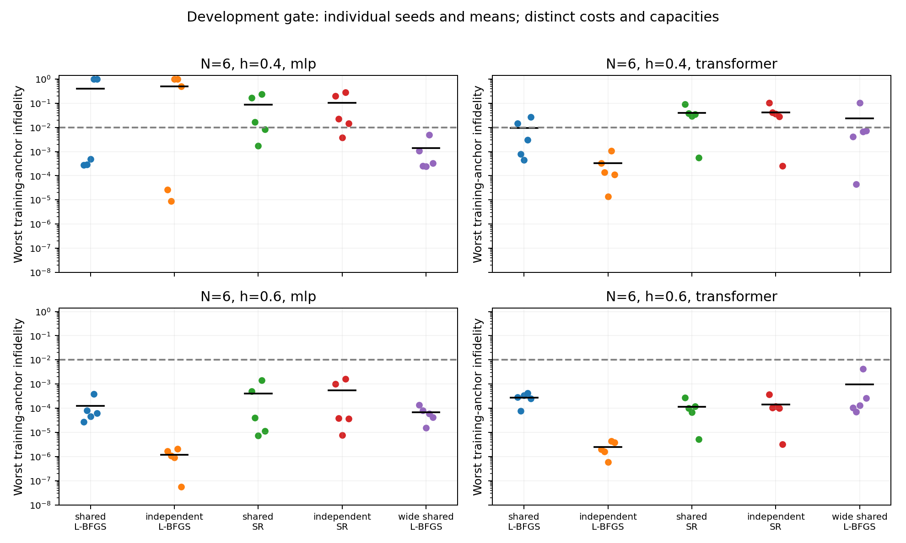

# 条件量子态研究：SR 基线、容量反例与路线收缩

2026-10-23 / 第六轮 / Issue #11 / AI 辅助研究记录

## 1. 本轮改变了什么判断

第五轮留下的问题是：低场下独立 Transformer 配合 L-BFGS 比共享模型更可靠，是否值得以共享训练失效作为论文主线？第六轮补入经过解析检查的 SR 优化基线，以及参数量接近三个独立模型总量的加宽共享网络。结果要求进一步收缩主张：共享本身仍不能被认定为关键失败机制；网络规模和训练路径是必须保留的替代解释。

observed：低场加宽共享 MLP 的五个种子全部达到预设训练精度，加宽共享 Transformer 为4/5。固定 SR 设置下，低场共享/独立 MLP 分别为2/5、1/5，Transformer 均为1/5。独立化没有带来一致改善。加宽 Transformer 虽通过4/5门槛，却因一个失败种子导致平均误差高于原共享模型；不能只选达标次数讲成功故事。

研究决策：撤回把“共享特有失效”提升为论文贡献的倾向，保留近简并条件求解的可靠性与总成本问题。先做有限的优化收敛检查，并用强共享/独立模型和已知 Ritz 后处理构造基线，再冻结新尺寸验证。当前不引入新架构或主动选点算法，也不把普通 SR 或加宽网络包装成新方法。

Material Passport：code experiment / descriptive validation，输入为前五轮研究，输出为60组主运行、一次同机重跑、完整原始证据与路线调整。observed 为实测，derived 为条件推导，planned 为后续事项。仍无独立成员复核，不是 ICLR 投稿终稿。期末第12题原始多 h、内插/外推任务与本轮机制研究分别保留。

## 2. SR 的定义与正确性检查

derived：对归一化实振幅 psi_k，令 J_k 为参数导数，T_k 为去掉沿态本身方向后的切向导数。将 K 个条件的 T_k 除以 sqrt(K) 后纵向拼接为 A；将每自旋残差 (H_k-E_k)psi_k/N 同样拼接为 b。于是 S=A^T A 是平均实态量子几何张量，f=A^T b 是平均每自旋能量梯度的一半。

加正对角偏移 δ 后，解 (S+δI)d=f，并更新 theta'=theta-eta*d。通过恒等式 d=A^T(AA^T+δI)^(-1)b 使用较小的核矩阵求解；这不要求 A 满秩。使用的是半梯度约定，目标又按 N 归一化，因此对应的切向虚时步长是 eta/N。完整推导和假设见[理论记录](theory_round6.md)。

验证包括：概率加权的对数导数协方差与振幅切向矩阵一致；独立自动微分核对2f；中心有限差分核对网络 Jacobian；原空间与对偶空间阻尼解一致；单自旋 psi=(cos t,sin t)、H=-X 给出解析方向 d=-cos(2t)/(1+δ)。两种网络均通过这些检查。全套29项测试在正式训练前通过。

SR、对角正则、核矩阵表示和回溯均为已知技术。[NetKet 的 SR/QGT 文档](https://netket.readthedocs.io/en/latest/user-guides/sr.html)是本轮公式与实现背景来源，[MinSR](https://arxiv.org/abs/2302.01941v3)提供相关优化工作的文献边界。本轮读取了前者相关章节和后者元数据/摘要，没有复现 NetKet 或 MinSR 的发表性能，也未实现随机采样 VMC。

## 3. 冻结设计与主结果

数值源码及配置在 d420a9df24eb69af8f8219fa46a0882592e321b8 冻结。N=6，h={0.4,0.6}，MLP/Transformer，seed={17,29,43,61,73}，共享 SR、独立 SR、加宽共享 L-BFGS 三组交叉，共60组。训练和测试网格均明确复用第五轮作为开发数据，不能宣称新数据泛化。每个 h 单独训练；精确对角化在每组所有模型冻结后执行。

SR 每模型300步，δ=1e-4，名义 eta=1，切向位移上限0.1，最多六次训练能量 Armijo 回溯。加宽 L-BFGS 使用1200次 closure、强 Wolfe 线搜索、学习率1、历史长度20，预算耗尽时恢复最后接受参数。均不用验证或测试选模。完整协议见[事前冻结记录](round6_preregistration.md)。

加宽 MLP 有4621个参数，三个窄独立模型共4707，差约-1.83%；加宽 Transformer 为6973，对照7347，差约-5.09%。这是近似参数量对照，未匹配初始函数、每层结构、优化状态或更新路径。因此它能展示一个共享网络可以成功的反例，不能把效果纯粹归因为容量。

主指标为每个 seed 三个训练锚点中的最大不保真度，至少4/5种子 ≤0.01 才通过本轮可靠拟合门槛。下表均值 ± 五种子样本标准差，括号是达标数。标准差不是置信区间，开发阶段达标率也不是总体成功率保证。

| h / 模型 | 共享 SR | 独立 SR | 加宽共享 L-BFGS |
|---|---|---|---|
| 0.4 / MLP | 0.086537 ± 0.109855 (2/5) | 0.103581 ± 0.126560 (1/5) | 0.001365 ± 0.002013 (5/5) |
| 0.4 / Transformer | 0.038803 ± 0.032820 (1/5) | 0.041419 ± 0.037143 (1/5) | 0.023972 ± 0.043685 (4/5) |
| 0.6 / MLP | 0.000399 ± 0.000612 (5/5) | 0.000545 ± 0.000743 (5/5) | 0.0000672 ± 0.0000461 (5/5) |
| 0.6 / Transformer | 0.000113 ± 0.000099 (5/5) | 0.000139 ± 0.000136 (5/5) | 0.000958 ± 0.001828 (5/5) |

observed：原窄 MLP 在低场 L-BFGS 下共享3/5、独立2/5，加宽共享为5/5；原窄 Transformer 共享3/5、独立5/5，加宽共享为4/5。SR 则低场共享与独立都未通过门槛，高场全部通过。既不能把低场失败统一归于共享，也不能说某一优化器普遍解决了它。

必须保留的反例：低场加宽 Transformer 的 seed43 最差锚点不保真度为0.101955，导致均值0.023972高于窄共享 L-BFGS 的0.009247。高场加宽 Transformer 的均值0.000958也高于窄共享0.000273。加宽通过操作门槛并不等于平均精度提升，更不等于稳健优于独立模型。

## 4. 优化收敛、泛化和总成本

observed：全部 SR 线性解的最大相对残差为7.24e-9；所有外层步都在第一次回溯试探被接受，训练能量不增。仍有低场保真度误差，说明“方程算对了”和“有限预算找到了基态”是不同验收项。仅测试一个固定阻尼和步长设置，不能推出 SR 普遍失效。

derived / 未证实机制：每自旋目标下300步、eta≤1对应名义虚时最多50。理想连续虚时中激发/基态系数比按 exp[-tau(E_i-E0)] 衰减，小隙可使收敛慢。但网络、阻尼和离散步会改变动力学，尚未证明这是本轮错误的主因；训练未使用精确隙调参。

训练锚点拟合改善也不自动保证插值。低场加宽 MLP/Transformer 的平均测试不保真度分别为0.067865/0.065864；同组训练态 Ritz 分别降为0.0001164/0.0021823。第五轮独立 L-BFGS Transformer 的 Ritz 仍约0.00004397。该已知方法必须作为强基线，不能仅与较弱的振幅查表比较。

| 架构 / 方式 | 每组训练 H 作用 | 平均 wall 秒 |
|---|---|---|
| MLP 共享 SR / 独立 SR | 各1800 | 3.814 / 3.438 |
| MLP 加宽 L-BFGS | 7200 | 2.730 |
| Transformer 共享 SR / 独立 SR | 各1800 | 9.115 / 8.741 |
| Transformer 加宽 L-BFGS | 7200 | 7.925 |

墙钟均值跨两个 h、各五种子，仅描述本机实现成本，不作为跨 h 科学效应合并。SR 不对 H 反传，因此 H 作用少；但每组还计算57600行标量振幅导数，共享/独立的最大核矩阵维数分别192/64。Jacobians 与线性求解使本机 SR 仍较慢。表中差异不是等总算力比较，也不代表高效实现的 SR 性能上限。

manifest 的 training_model_calls 以完整构型遍历计费；SR 的导数使用每块32构型的 vmap，实际底层调用与普通全批前向不同，不能直接按这个计数比较 FLOPs。每组另有13次评估用 ED、按指标行计的 H 作用和 Ritz 子空间 H 作用。主运行 wall 合计357.633秒，不含重跑、测试、统计、报告与进程间开销。

<!-- pagebreak -->

## 5. 证据核验与协作整合

60组无失败或替换种子，保存2260行指标和380个新端点；40个 SR 初始权重与第五轮哈希一致。共享 SR Transformer、h=0.4、seed17 同机重跑的配置、历史、振幅、指标和权重哈希完全一致，未进入统计，也不构成跨成员复现。

核验入口 scripts/verify_round6.py，汇总入口 scripts/summarize_round6.py。全量表格、成本、配对差值与证据检查在 docs/results/round6，测试和PDF检查记录在 validation.json。更新 main 依据用户本轮明确授权；先合入远程19a8683的 README 改动，保留全部研究提交历史，再发布通过检查的版本。分支整合不等于独立科研评审，正式科学主张仍标为 provisional。

## 6. 下一步及停止条件

planned：先在开发数据做有界 SR 收敛检查，区分阻尼、累计时间与参数化，禁止 ED 或测试驱动调参；保留强 L-BFGS，分开报告 H 工作、更新与时间。

planned：随后冻结 N=8/10、新 h/种子的可靠性与训练加 Q 次查询成本对照，包含强共享、独立网络和 Ritz。共享机制差异消失则撤回因果叙事，无总成本优势则保留负面结论。跨尺寸仍有价值，才推进另一族哈密顿量和随机采样。

严格容量/更新匹配、尺寸泛化与新颖性验证尚未完成。课程成果可独立整理；成员实际阅读、分工、答辩和独立复核须补齐。
