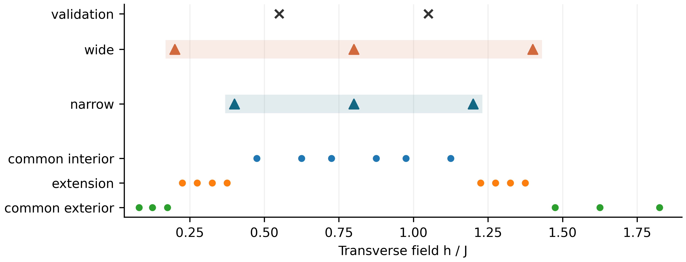
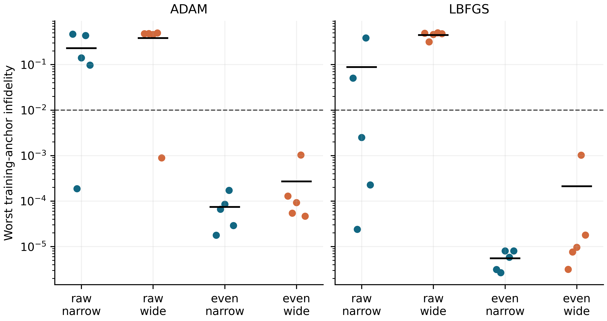
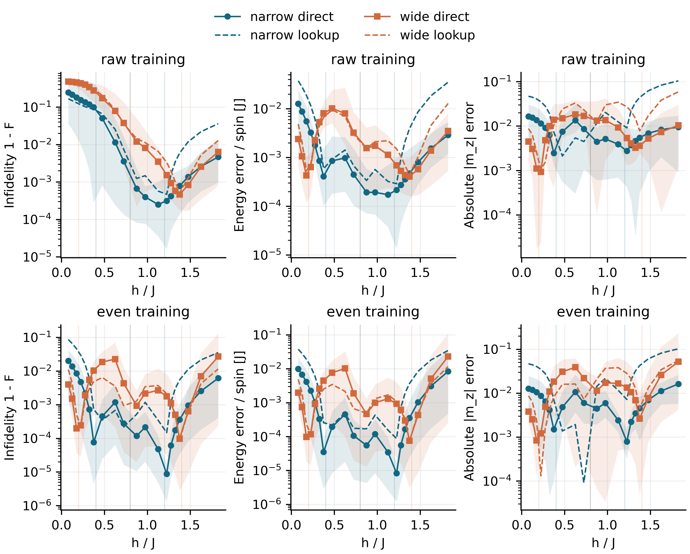
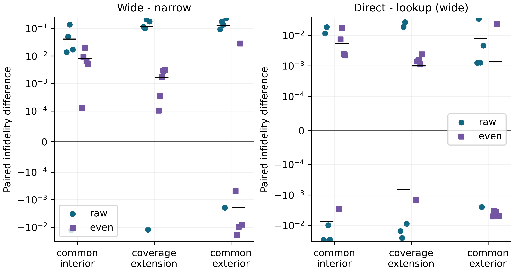
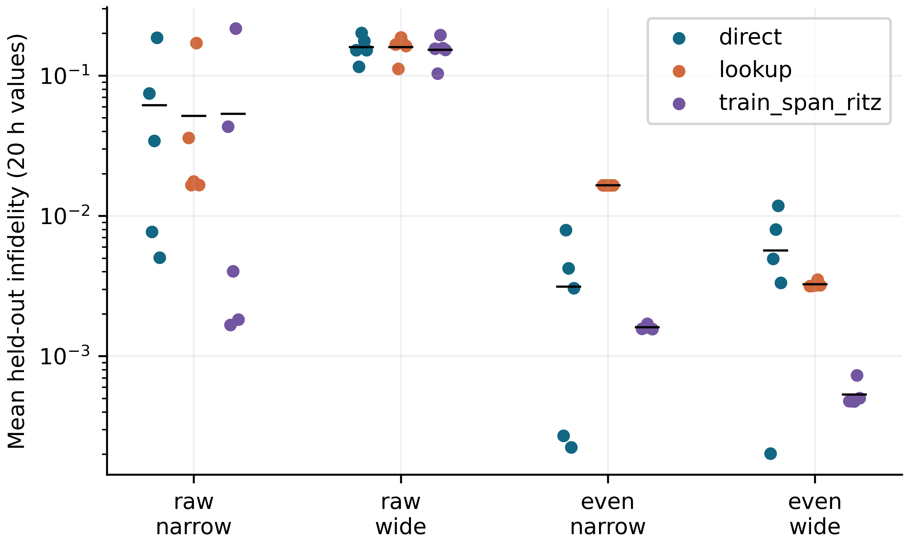

# 条件Transformer对未见横场的泛化
## 第七轮：训练可靠性与参数覆盖范围

量子机器学习结课研究 · 课题12 · 2026年10月27日

### 摘要

条件网络在训练点尚未学准时，扩大训练区间能否改善外推便难以单独判断。本轮固定六自旋开放Ising链，使用同样的三个训练点预算，将横场覆盖从[0.4,1.2]扩大为[0.2,1.4]，以五个新种子比较未见横场上的能量、平方保真度与磁化。60组事前冻结实验全部完成。主比较的原始自回归Transformer在宽区间没有种子通过训练精度门槛，共同外推平均不保真度的配对差为+0.1273，未支持覆盖改善。作为预定物理对照，正宇称训练在两种覆盖下均达到训练门槛；扩大区间仍使五个种子的共同插值误差全部增大。窄区间条件预测可优于同源查表，但优势随覆盖和强基准改变。这些结果把训练点精度、布点干预和预测规则区分开来，给出了本题有限系统中泛化成立的具体条件。

### 本轮承接的问题

原题问“一套权重能否在未见h上给出正确量子态”。前六轮已显示，低能量误差、共享网络、更多预算和更强优化之间存在混杂。本轮回到课程指定的h>0、固定链长任务，只研究一个主问题：在固定点数与训练预算下，扩大横场覆盖范围能否改善外推？

|已有工作|它怎样约束本轮|
|---|---|
|第1轮建立多h能量训练、查表及对称性对照|沿用可信模型和物理实现，先跨环境复跑一个原配置|
|第2至4轮检查选模、缩放与坐标等价性|共同验证能量选模；保留最终接受参数；不重做缩放叙事|
|第5至6轮检查优化、独立化与容量|同时保留Adam、L-BFGS与MLP；不把失败唯一归因于参数共享|

主假设是“扩大覆盖能降低共同外推误差”。竞争解释是低场训练本身更困难，或相同点数扩大范围后点间距变大。两种覆盖同时改变这些因素，因此本实验检验明确的布点方案，而不是孤立估计距离的普适因果效应。

本轮是新的数值研究记录。它以本地冻结协议和可运行证据支持结论；团队成员的独立复核与个人答辩理解另行记录。

<!-- pagebreak -->
## 1. 从原文到本题的模型

采用开放边界、J=1、h>0，计算基按最左自旋为最高位排列。Pauli矩阵本征值为±1，能量以J计。

$$H(h)=-\sum_{i=1}^{5}Z_iZ_{i+1}-h\sum_{i=1}^{6}X_i.$$

$$p_\theta(\mathbf{s}\mid h)=\prod_{i=1}^{6}p_\theta(s_i\mid\mathbf{s}_{<i},h),\qquad\psi_\theta(\mathbf{s};h)=\sqrt{p_\theta(\mathbf{s}\mid h)}.$$

图1对应必读论文图1及式(1)的条件输入、右移与自回归分解[1]。h>0使计算基上的非对角元非正且连通，有限链基态可选为严格正实振幅，因此本题保留振幅输出即可。相位输出和跨链长任务属于原文的更广设置。

![图1　本题网络与原文方法的对应。条件输入实际为[h,0]；第二分量沿用已有接口并固定为零。示意图中的Bernoulli概率以一个logit实现，与两类softmax的概率参数化等价。](results/round7/model_correspondence.png)

预测s_i的输出位于输入序列的第i个自旋位置：它对应BOS或s_(i-1)，可读h、BOS与s_1到s_(i-1)，不能读s_i及其后缀。h token本身只能读自身。这里的自回归对象是自旋构型，序列位置没有物理时间含义。

链式概率的归一化来自对最后一个自旋逐项求和，再依次消去前面的条件概率。它不要求自旋相互独立；历史前缀正是表示关联的条件。训练和评估全程dropout=0，使用同一前缀时条件概率确定。

|关系|本题实际选择|
|---|---|
|沿用原文|条件token、因果注意力、右移自旋、自回归概率、变分能量|
|本组简化|固定L=6、64构型全枚举、实正振幅、小型单层网络、三个h等权能量平均|
|本轮改动|新种子及保留点、窄/宽覆盖配对、接受步上的验证选模、预算与振幅复算|

Transformer为16维、2头、FFN宽32、单层，共2449参数。MLP为两层32宽tanh，共1569参数。二者容量不等，比较用于检查现象是否依赖注意力结构。

<!-- pagebreak -->
## 2. 冻结划分、目标与对照

配置为experiments/configs/round7.json，训练源码冻结于3f1aaa9c9faf。以下划分在执行前写入本地Git；它不是外部注册平台的预注册。

|用途|横场h/J|
|---|---|
|窄覆盖narrow训练|0.4, 0.8, 1.2|
|宽覆盖wide训练|0.2, 0.8, 1.4|
|共同验证|0.55, 1.05|
|共同插值，6点|0.475, 0.625, 0.725, 0.875, 0.975, 1.125|
|覆盖延伸，8点|0.225, 0.275, 0.325, 0.375, 1.225, 1.275, 1.325, 1.375|
|共同外推，6点|0.08, 0.125, 0.175, 1.475, 1.625, 1.825|

$$\mathcal{L}(\theta)=\frac{1}{3}\sum_{h\in\mathcal{H}_{\rm tr}}\frac{\langle\psi_\theta(h)|H(h)|\psi_\theta(h)\rangle}{6}.$$

Transformer采用Adam/L-BFGS × raw/even × 两种覆盖 × 五种子，共40组；MLP采用L-BFGS × raw/even × 两种覆盖 × 同五种子，共20组。种子为101、211、307、401、503；同架构同种子的起始参数哈希相同。

raw直接使用链式振幅；even使用归一化的psi+Ppsi，P为全自旋翻转。本题P与H对易，唯一正基态属于正宇称。even是显式加入已知物理信息的全枚举变分对照；其最终态的逐自旋直接采样性质需另行分析。

每组1200次完整目标/梯度closure。Adam学习率0.005；L-BFGS学习率1、history=20、max_iter=1、strong-Wolfe[3,4]，所有试探调用计费。每约100次closure后，只在已接受参数上计算共同验证变分能量并选择最低者。selected为主终点，final保留最后接受参数；两者冻结后才调用ED进行评估。

<!-- pagebreak -->
## 3. 先检验训练点是否学准

事前门槛为：每个种子三个训练锚点中最大的1-F不超过0.01；每种覆盖至少4/5种子达标。主比较固定为raw Transformer、L-BFGS、selected，五种子的共同外推平均1-F。覆盖改善还要求配对均值为负且至少4/5种子改善。

|优化器/训练|narrow达标数|wide达标数|narrow最坏锚点1-F均值|wide最坏锚点1-F均值|
|---|---|---|---|---|
|adam/raw|1/5|1/5|0.228101|0.382202|
|adam/even|5/5|5/5|7.40701e-05|0.000270111|
|lbfgs/raw|3/5|0/5|0.0878326|0.446507|
|lbfgs/even|5/5|5/5|5.53027e-06|0.00021194|

主配置在narrow有3/5、wide有0/5种子达标，两侧训练门槛未通过。宽覆盖共同外推的平均1-F为0.235765，窄覆盖为0.108487；其差包含训练不充分的影响，不能单独归为覆盖效应。

这种限制有直接物理依据。对非简并基态，谱分解给出总能量误差epsilon与能隙Delta的标准关系：

$$\epsilon=E_\theta-E_0\geq\Delta(1-F),\qquad F=|\langle\psi_0|\psi_\theta\rangle|^2.$$

h=0.2处能隙为1.2288×10^-4 J。以主配置seed401为例，每自旋能量误差仅4.5559×10^-5 J，F却为0.502331，P期望约0.004717。小能隙使这个能量误差不足以约束高保真度；低能的近简并分支可产生这种现象。它与优化未收敛、有限参数化等解释仍有关联，不能凭投影的收益把原因唯一归为某种优化机制。

even对照的两种覆盖均5/5达标，支持继续比较其未见横场误差；它保持控制身份，不取代未通过的主配置。

<!-- pagebreak -->
## 4. 未见横场上的三种评价

能量误差为(E-E0)/6；保真度F采用平方定义。非能量物理量选A=|sum Z_i/6|的期望，比较其与ED基态的绝对差。另保存Z1磁化、端到端连通关联、宇称及方差，用于检查只看能量遗漏的态差异。

|训练/覆盖|共同插值1-F|覆盖延伸1-F|共同外推1-F|
|---|---|---|---|
|raw/narrow|0.0111428 ± 0.0217|0.0640159 ± 0.101|0.108487 ± 0.0999|
|raw/wide|0.0524332 ± 0.05|0.182273 ± 0.0495|0.235765 ± 0.0225|
|even/narrow|0.000380844 ± 0.000519|0.00104111 ± 0.00109|0.00867295 ± 0.00867|
|even/wide|0.00853848 ± 0.00759|0.00267347 ± 0.00148|0.00673468 ± 0.0125|

表中先对每个种子的区域网格求均值，再报五种子的均值±样本SD。h点不是独立重复。even中共同插值误差由0.000380844升至0.00853848，覆盖延伸也变差；共同外推的均值下降幅度远小于种子间差异。扩大训练区间同时稀疏了内部覆盖，并未形成整体更准的条件态族。

raw中能量和保真度的趋势明显不同。图中较小的能量误差不能替代对训练点及保留点的态精度检查。

<!-- pagebreak -->
## 5. 配对覆盖效应与同源查表

lookup完全取自同一个冻结网络在三个训练h上生成的正振幅：区间内线性插值后归一化，区间外保持最近边界态。它不使用测试精确态，也不另行训练，因此检验的是向网络输入新h是否比保持已学训练态更有价值。

|种子|raw：wide减narrow|even：wide减narrow|
|---|---|---|
|101|+0.0925818|-0.00048837|
|211|+0.176338|-0.0195427|
|307|+0.136206|-0.00970804|
|401|-0.00195262|+0.0283321|
|503|+0.233219|-0.00828433|

主配置共同外推配对差均值+0.127278±0.0889，仅1/5种子改善，且训练门槛失败，预定改善判据未通过。even控制的配对差为-0.00193827±0.0182，4/5改善；seed401反向变化+0.0283321。该控制提供一个有条件的均值改善观察，不能替换主比较，也不能支持稳定或普遍的改善。

even窄覆盖在共同外推上，direct减lookup为-0.0355802±0.00867，五种子均改善；even宽覆盖则为+0.00135923±0.0125，四种子改善却均值变差。共同插值中，even的wide减narrow五种子全部为正。胜出次数、平均幅度和训练可靠性必须一起读。

这些对照排除了“只要同一网络在多个h上降能，就必然学到可靠外推规则”的推断。它们也显示，一部分有用的条件关系确实能被学到：even窄覆盖在本轮共同外推网格上超过了同源边界保持。

<!-- pagebreak -->
## 6. 强基准与物理量交叉检查

train-span Ritz以相同冻结训练态张成最多三维子空间，用目标H(h)的投影矩阵求最低Ritz态[5]。它不以精确基态建基，另有后处理矩阵作用成本。它是额外的已知强基准，不能与不做目标h求解的lookup混为一谈。

|训练/覆盖|direct|同源lookup|同源train-span Ritz|
|---|---|---|---|
|raw/narrow|0.0614952 ± 0.075|0.051554 ± 0.0673|0.0534693 ± 0.0928|
|raw/wide|0.159369 ± 0.0319|0.159526 ± 0.0283|0.152728 ± 0.0325|
|even/narrow|0.00313258 ± 0.00319|0.0165323 ± 5.08e-06|0.00160254 ± 5.83e-05|
|even/wide|0.00565134 ± 0.00444|0.00324742 ± 0.00015|0.00053302 ± 0.00011|

表中even宽覆盖Ritz均值0.000533020，低于direct的0.00565134；even窄覆盖也有相同均值次序。优于简单查表不足以建立对强基准的优势，Ritz的能量最优性质也不自动保证保真度最优。

|训练/覆盖|每自旋能量误差/J|绝对磁化误差|
|---|---|---|
|raw/narrow|0.00213522 ± 0.000901|0.00795991 ± 0.00425|
|raw/wide|0.00267924 ± 0.0019|0.00818724 ± 0.00373|
|even/narrow|0.00191676 ± 0.00216|0.00676521 ± 0.00432|
|even/wide|0.00319172 ± 0.00319|0.0148962 ± 0.0138|

绝对磁化对全局翻转不变；两种相反磁化分支及其对称组合可能给出接近的该物理量，因而即使它准确，量子态仍可能不准。这解释了同时报告F与非能量观测量的必要性。

MLP的even窄覆盖direct平均1-F为0.000568504±0.000284，Transformer为0.00313258±0.00319。该比较未匹配参数量及架构成本，结果只表明此网格上的条件预测收益并不专属于注意力网络。

<!-- pagebreak -->
## 7. 可复现性与实际计算预算

60组主运行无失败；共9000条指标，包括25个h × 3方法 × 2终点 × 60组。25个h包含3训练、2验证及20保留点。所有种子、区域和最终参数均保留，未按测试误差更换设置。

|计算或核验|实际记录|
|---|---|
|每组训练工作|1200 closure；3600次前向H作用及3600次反向H作用|
|60组训练总工作|432000次前向加反向H作用|
|验证与ED|每组24次验证h评价；每组冻结后25次ED；合计1440及1500次|
|训练计时之和|334.495秒；含循环与验证选模|
|各组wall time之和|337.795秒；不含环境安装、作图、写作与额外重跑|
|实际环境|Windows 11，Python 3.12.14，torch 2.14.1+cpu，NumPy 2.3.5，SciPy 1.16.3|
|执行方式|CPU、单线程、float64；完整依赖另存requirements-round7-lock.txt|

even在已枚举的64维数组上翻转并归一化，每次仍只需一次原网络全构型调用，但增加投影运算。相同closure和H作用不等于所有计算成本相同；本轮计时没有回答大系统或训练加多次查询的摊销优势。

33项测试通过，包含原29项和4项新增的分区、选模无ED、已接受参数回调及本地manifest检查。全部运行的原始概率归一化最大误差为2.22×10^-16，枚举后缀变化造成的因果性logit最大差为0。训练/评估模式的浮点差异亦在设定容差内。

复算使用保存的振幅、NumPy eigh及物理实现，检查9000条记录；数值最大差1.084×10^-8，能量容差1e-9、保真度容差1e-6，全部通过。该复算覆盖保存状态的评价，不等于重跑所有训练。

原第1轮even Transformer seed17在本轮环境重新训练，1311个数值指标/训练值与原记录最大差0。新固定配置raw/L-BFGS/wide seed101另目录重跑，10136个指标、训练值与振幅数值逐值相同。这两次都是本Agent运行的复现，独立人类成员复核状态仍为待完成。

selected与final均保存。raw宽覆盖全部保留点平均1-F分别为0.159369及0.183999；final未消除该配置的训练问题。所用源码、配置哈希、初始化与终点参数哈希、命令及预算可从每份manifest追溯。

<!-- pagebreak -->
## 8. 本轮结论与交接

在固定六自旋、三个训练h与1200 closure的条件下，原始自回归Transformer的宽覆盖训练没有达到预定门槛，主假设未获支持。even物理对照使训练点达到门槛后，覆盖扩大仍造成共同插值退化；共同外推呈现带有大幅反例的条件性均值改善。窄覆盖的条件网络可超过同源查表，强Ritz基准则进一步收紧了这种精度收益的含义。

因此，本题的回答是有条件的：一个条件网络在本轮部分设置中能泛化到未见h，但训练能量下降和更广覆盖本身不足以保证态准确。这个判断来自训练锚点、配对布点和同源预测规则三个相互补充的证据。

最有价值的下一步是由另一成员按固定run和环境复核训练与图表，再在独立开发h上限定地改善raw宽覆盖训练。如果需要比较新的训练规则，应在新的保留点上重新冻结验证；当前20个h已被本轮分析使用。固定L=6的结果用于有限量子态数值逼近，不能从中提取热力学临界指数。

### 课程材料与实际完成状态

|课程要求|本轮位置与状态|
|---|---|
|研究报告PDF|本报告及同名Markdown、6幅图的PNG/PDF与绘图源码|
|文献学习记录|literature_round7.md：原文定位、概念推导、公式与本题差异；成员需另补本人理解|
|可复现材料|完整源码、冻结配置、60组原始数据及2次重跑、依赖锁定、复现脚本与核验结果|
|过程与分工|process_round7.md及handoff：决策、负结果、AI用途和真实待办；不编造成员贡献|

本轮交付是一份可继续审核的阶段研究文件。课程最终成员署名、个人分工、教师另行通知的篇幅/时长、汇报PPT及现场答辩应在小组整合时完成，不能由运行记录代替。

### 参考文献与一手资料

[1] Y.-H. Zhang and M. Di Ventra, Transformer Quantum State: A Multi-Purpose Model for Quantum Many-Body Problems, Physical Review B 107, 075147 (2023). [arXiv v4](https://arxiv.org/abs/2208.01758v4)，重点图1、式(1)、图2/4及附录G.2。

[2] 作者实现：[transformer_quantum_state](https://github.com/yuanhangzhang98/transformer_quantum_state)。用于定位条件编码、右移与因果结构；本题沿用小型实现，不运行其全部任务。

[3] PyTorch 2.14 [LBFGS官方文档](https://docs.pytorch.org/docs/2.14/generated/torch.optim.LBFGS.html)：closure、history_size和strong_wolfe参数。软件版本以本轮锁定环境为准。

[4] PyTorch 2.14 [Adam官方文档](https://docs.pytorch.org/docs/2.14/generated/torch.optim.Adam.html)：优化参数定义。本轮显式设置学习率，未通过测试h选参。

[5] A. Sarkar and D. Lee, Self-learning emulators and eigenvector continuation, Physical Review Research 4, 023214 (2022), [arXiv:2107.13449v2](https://arxiv.org/abs/2107.13449v2)。本轮只核验元数据及摘要，用于已知子空间方法的背景；不据此宣称完成其全文方法复现。

项目来源：团队仓库main 65c367c7115d；科学代码冻结3f1aaa9c9faf；新研究在本地分支归档。写作采用APS Quantum Writing 1.2.0，以课程要求决定结构与篇幅。
