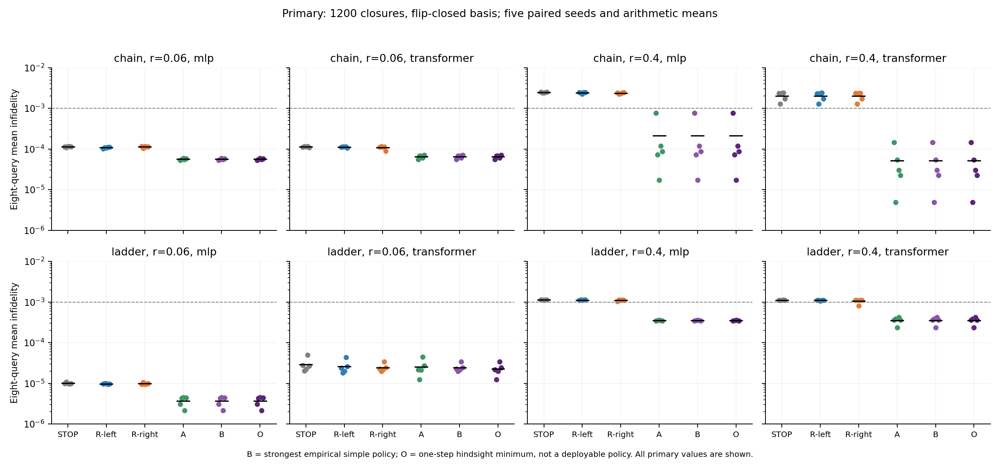
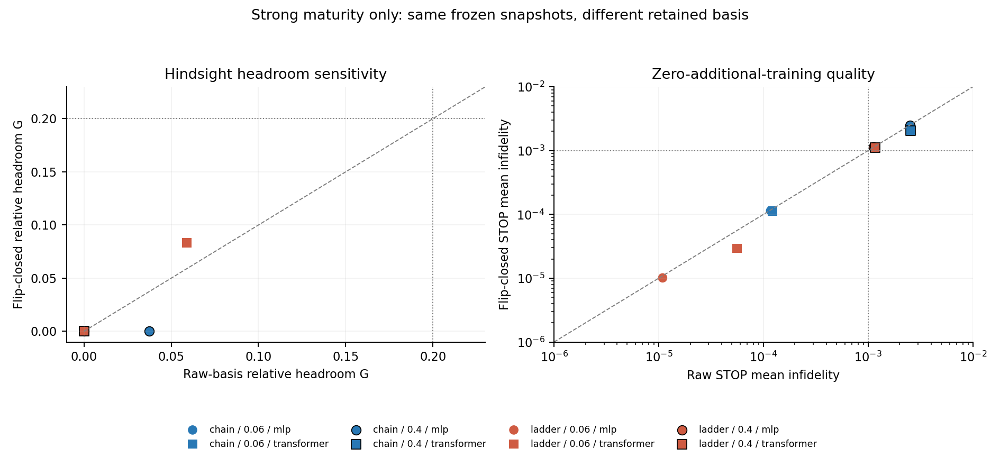

# 精修还是加点：一次事前冻结的止损实验

## 第八轮：强简单策略之后，还剩多少调度空间？

课题12扩展研究 · 2026-10-27 · Issue19 · AI辅助研究记录

### 结论先行

本轮不支持在当前任务上开发复杂的精修/加点调度器。40组主实验全部完成，主端点的8个条件没有一个通过事前投资门槛。7个条件中，固定中心加点已经等于逐种子事后选动作的最优结果；唯一非零主收益为8.32%，绝对平均不保真度改善仅2.05×10^-6。所有主条件的最强简单策略误差均低于预设的10^-3下限。

这个判断关闭的是本轮固定任务、动作菜单和预算上的方法开发，不是关于全部预算分配问题的不可能性结论。它也不意味着翻转闭包本身解决了全部任务：宽区间中STOP仍有约10^-3量级误差，固定中心加点进一步降低了误差。当前没有新调度算法、部署成本收益、重采样收益或ICLR论文成熟度的证据。

### 为什么做这轮

前七轮及[选题评估](research_direction_20261027.md)指出，训练可靠性、参数覆盖和强Ritz基线会改变条件网络的表面优势。直接进入复杂调度器开发，可能只是在弱基线留下的空间上做文章。因此先问更便宜、可证伪的问题：即使事后知道各动作的真实误差，从精修旧点和增加新点中挑选，能否明显超过强简单策略？

答案若为否，就应先止损；若为是，也只说明值得研究允许信息能否预测动作价值。事后oracle不是可部署策略。

### 证据与状态

数值源码、配置和协议先冻结于d2595d75514862b09fb41d6ea004cac191c88015，再运行40个配置及一个独立目录中的同机重跑。主数据含8280行物理指标、960个查询种子端点和120个相关的成熟度决策；统计重复单位是5个配对种子。

工程正确性、保存证据复算与同机重跑分别记录；独立人类复核仍未完成。Astra实际参与了事前设计咨询，接受的约束及其未独立审阅源码的边界见[设计回执](results/round8/design_review.json)。本报告不将AI建议写成人类评审或论文接收判断。

<!-- pagebreak -->
## 1. 事前设计与动作的准确含义

N=8，开放链h=0.55与两腿开放梯h=1.15，各取纵场半径r=0.06和0.4，比较MLP与Transformer，种子107/223/311/419/521。哈密顿量为H=-Σ边Z_iZ_j-hΣX_i+λZ_0；两腿梯有10条边。每个配置在λ=-r,+r各训练一套独立端点模型，使用相同初始权重。网络有条件输入，但本轮不检验一套共享权重学习整个参数族。

端点模型累计训练成熟度为100、400、1200次目标/梯度closure，由100、300、800三块连续构成。每次决策复制完整模型、优化器和随机数状态；查询为r乘以±{0.08,0.3,0.65,0.9}，排除旧端点和拟增加的中心。

| 动作 | 操作 | 额外训练closure上限 |
|---|---|---|
| STOP | 保留当前两个快照 | 0 |
| R-left / R-right | 延续对应旧点优化器，追加精修态，保留全部旧态 | 各200 |
| A-center | 两个旧模型在中心按初始变分能量选热启动，重置优化器，在中心训练并追加 | 200 |

因此比较的是完整动作包。R继承优化器记忆、A重置优化器；新点固定在中心。结果不能归因为“覆盖天然优于精度”，也不覆盖任意重启策略、任意新点或多步决策。

所有动作同时输出raw及翻转闭包基。已知P=ΠX_i满足H(-λ)=PH(λ)P；将每个态的P像加入基，不增加训练，但需计入投影和线性代数。STOP闭包至多4个向量，其余至多6个。它是已知物理强基线，不是本项目创新。

最强简单策略集合包括四种常数动作、按旧锚点残差选左右精修、按当前闭包Ritz态在左/中/右的残差选R/A。后两者只用允许信息，另计5次H探测。A热启动另计2次H作用和网络遍历。ED、真实保真度及能隙仅在同一配置的全部成熟度和动作预测冻结后用于评估。

### 预设判据

令e_s,a为某种子某动作在8个查询上的平均不保真度。B为六种简单策略中跨种子平均误差的最小值，O为跨种子平均的逐种子动作最小值，G=(B-O)/B。B及O都是这个开发先导上的事后汇总，不是泛化评估；B=0时定义G=0。

主端点仅为1200成熟度和翻转闭包。单条件须B≥10^-3、G≥20%、每次留一种子重选简单基线后的G≥10%；至少2个合格条件覆盖两种物理家族。另须R和A各在至少2个不同种子上胜过另一类型及STOP超过10^-4。门槛用于研究投入决策，不是显著性标准或ICLR接收标准。完整约定见[冻结协议](round8_preregistration.md)。

<!-- pagebreak -->
## 2. 主结果：选择空间主要被固定加点消除

下表每项先在8个查询上平均，再对5种子平均。B、O均为不保真度；G为相对空间。只有梯窄Transformer的最强简单策略是R-right，其余均是A-center。

| 家族 / r / 模型 | B | O | G | 留一G最小值 |
|---|---|---|---|---|
| 链 / .06 / MLP | 5.619e-5 | 5.619e-5 | 0 | 0 |
| 链 / .06 / Transformer | 6.485e-5 | 6.485e-5 | 0 | 0 |
| 链 / .4 / MLP | 2.142e-4 | 2.142e-4 | 0 | 0 |
| 链 / .4 / Transformer | 5.129e-5 | 5.129e-5 | 0 | 0 |
| 梯 / .06 / MLP | 3.728e-6 | 3.728e-6 | 0 | 0 |
| 梯 / .06 / Transformer | 2.469e-5 | 2.264e-5 | 8.32% | 2.49% |
| 梯 / .4 / MLP | 3.543e-4 | 3.543e-4 | 0 | 0 |
| 梯 / .4 / Transformer | 3.535e-4 | 3.535e-4 | 0 | 0 |

宽区间的四个主条件中，A在全部5个种子上都比最佳左右精修和STOP低超过10^-4；没有任何主条件的种子出现同等幅度的R类型胜出。该菜单下缺少需要学习的R/A切换。窄区间已进入更小误差范围，不能因为相对百分数好看而忽略绝对尺度。

这不是“所有任务已由STOP解决”。宽区间闭包STOP误差分别为2.46e-3、2.03e-3、1.13e-3、1.11e-3；固定A后才下降到上表范围。全量种子值、均值/标准差、次要能量/方差/磁化/连通关联指标保存在[完整表](results/round8/tables.md)与逐行CSV，未只呈现保真度有利项。

<!-- pagebreak -->
## 3. 敏感性与成本：不把弱基线当作新贡献

在100成熟度的raw基中，最大的G为66.1%，但其留一种子最小G=0；其他早期条件也没有满足同样的单条件门槛。全部48个成熟度/基变体条件均未合格。它们仍作为探索结果完整保留，未改为主端点。成熟度与查询点不是新的独立重复。

40个主配置的实测顺序累计墙钟为649.18秒，CPU、float64、单PyTorch线程。一个配置包含所有反事实动作，不能把研究执行成本当成可部署oracle策略的成本。

| 成本项 | 主40配置合计 |
|---|---|
| 训练closure / 其中边界回滚消耗 | 168000 / 335 |
| 训练前向+反向H作用 | 336000 |
| 仿射投影分量作用 / 策略H探测 / 热启动H作用 | 11880 / 600 / 240 |
| 端点训练 / 反事实动作训练时间 | 355.93秒 / 268.24秒 |
| 全部基投影 / 小矩阵查询 / 评估重构 | .212秒 / .231秒 / .010秒 |
| ED评估调用 / 物理指标行 | 440 / 8280 |

不同操作单位不得相加成“总算力”。探测、缓存失效和热启动另列；额外训练closure上限相同，不代表总成本或墙钟相等。小矩阵查询是本机小系统测量，不能外推GPU、大尺寸、Born采样或完整波函数输出的摊销交叉点。

缓存先SVD得到正交基，再缓存Q^T H_j Q。能量与所列观测量查询无需完整H作用；全向量仅为声明的评估重构。主实验600个完整检查点约455.6MB，保存在本地忽略文件中，不上传GitHub；公开状态指纹、压缩振幅、历史、配置及再生命令。

<!-- pagebreak -->
## 4. 工程核验与解释边界

新矩阵自由H与仿射缓存模块对照独立Kronecker矩阵、原Ritz、复数/秩亏输入及PyTorch梯度。可恢复优化器保存曲率、计数、模型和Python/NumPy/Torch随机数状态。硬预算恰好截断线搜索时回滚整个未完成优化器调用，同时计入已耗工作；只主张同分块日程重放等价，不主张等于一次不间断L-BFGS。

全套50项测试通过；Windows首次全套检查有2项因沙箱系统临时目录权限失败，将TEMP/TMP仅在测试进程指向仓库tmp后，50项全部通过。没有为绕过失败而改动数值结果。工作区551份manifest校验通过，第七轮60组保存证据也重新核验通过。

独立Kronecker H与NumPy本征解复算全部8280行，最大保真度差1.90×10^-13、归一化误差2.66×10^-15；9600次子空间能量嵌套检查无违例。600个本地检查点以weights_only=True安全加载并核对完整状态指纹。同机重跑的预测、训练历史与指标文件逐字节一致，物理决策及15个检查点指纹一致，计时不要求相同。回执见[audit.json](results/round8/audit.json)和[replay_check.json](results/round8/replay_check.json)。这些检查不替代跨成员复跑；记录中的冻结时间及声明也不是防篡改的外部oracle访问日志。

### 当前能说什么

- observed：主8条件均未通过投资门槛；7个条件固定A等于菜单内逐种子oracle；全部48敏感性条件也没有合格条件。
- derived：在当前菜单与损失定义下，复杂选择策略没有已显示的可观改善空间，继续开发它的优先级应降低。这个推断不涉及所有未测动作。
- hypothesized：更自然的困难任务、含噪矩阵估计或不同输出要求可能留下空间。当前没有必要性、可学性、新颖性或净成本收益证据。
- planned：先独立复核和重新立题，再决定是否冻结下一轮；不为挽救当前叙事立即扩大尺寸、加入MC或调整门槛。

### 对最终目标的影响

本轮增加了可恢复实验、物理基线和可复核负结果，改善研究可信度；它没有形成ICLR级新贡献。已核验文献中的自适应快照、NQS/EC和累计查询成本先例仍适用，来源与阅读范围见[文献核验](literature_direction_20261027.md)。不能把已知闭包、Ritz缓存或“精修/加点”抽象选择本身包装成创新。

下一研究题必须先指出一个自然产生且强简单策略不能消除的瓶颈，给出可证伪机制，并说明相对最接近工作的新增点。若暂时找不到，应完成课程论文和可复现基准，而不是预先承诺顶会方法论文。课程第12题的多h共享训练、内插/外推证据仍由前七轮承接，本轮固定h的独立端点实验不能替代原题的那部分要求；个人理解与答辩由成员完成。

### 可直接接力

在依赖环境运行python scripts/verify_round8.py；保留本地检查点时另加--local-checkpoints。重建分析用python scripts/analyze_round8.py；完整复跑需干净的冻结源码树，按[交接19](handoffs/issue-19.md)使用run_round8的独立tag命令。运行索引不混入重跑，所有原始结果及负面种子保留。
